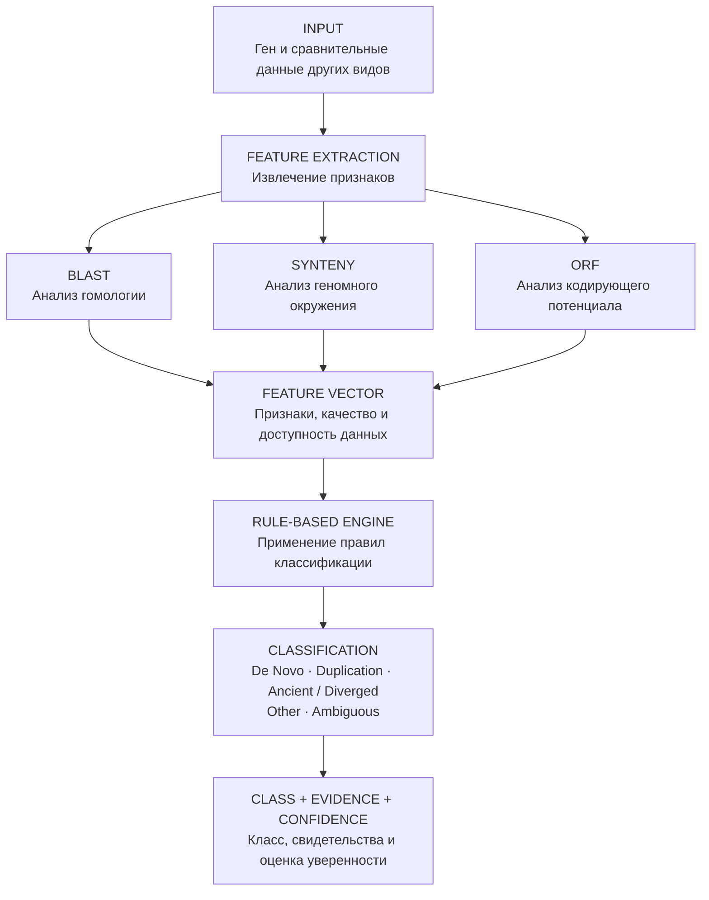
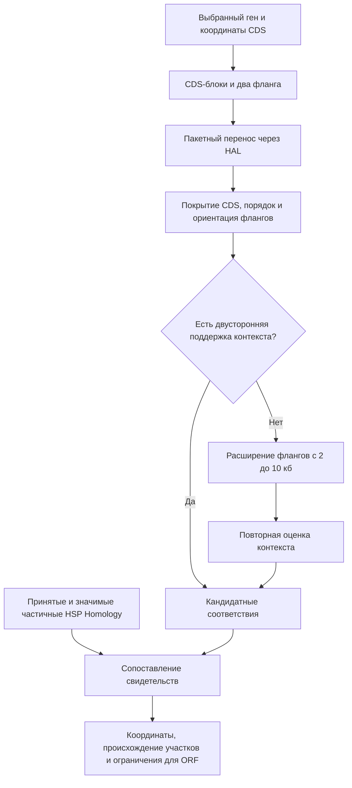
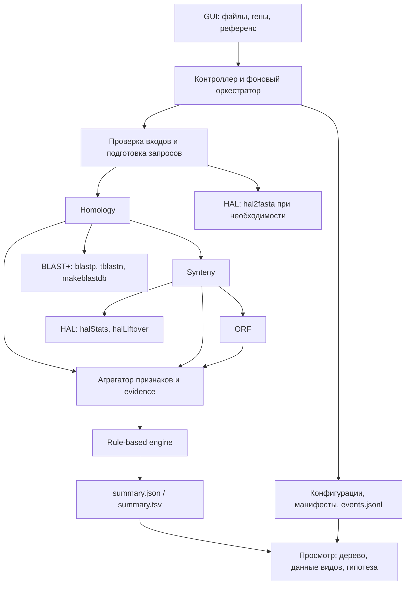

# Раздел 1. Резюме

## 1.1 Постановка задачи и соответствие требованиям кейса

Задача проекта: разработать систему определения наиболее вероятного эволюционного происхождения белок-кодирующих генов по последовательностям и сравнительным геномным данным. Прототип реализует шесть требований кейса:

1. **Приём исходных и сравнительных данных (5.1)** — загрузка последовательностей, аннотаций и межвидовых соответствий ([п.2.1](#21-общая-архитектура-решения-и-распределение-ролей), [п.2.2](#22-анализ-гомологии), [п.2.3](#23-анализ-геномного-окружения-и-синтении), [п.2.4](#24-анализ-кодирующего-потенциала-orf), [п.3.2](#32-архитектура-приложения)).
2. **Автоматизированный анализ нескольких генов (5.2)** — пакетная обработка в едином вычислительном конвейере ([п.2.2](#22-анализ-гомологии), [п.2.3](#23-анализ-геномного-окружения-и-синтении), [п.2.4](#24-анализ-кодирующего-потенциала-orf), [п.3.2](#32-архитектура-приложения)).
3. **Определение механизма происхождения или недостаточности данных (5.3)** — классификация по явным правилам с выделением класса Ambiguous ([п.2.5](#25-правила-принятия-решения-rule-based-engine), [п.3.3](#33-реализация-rule-based-engine-и-формирования-evidenceconfidence)).
4. **Представление конкретных свидетельств (5.4)** — сохранение результатов поиска сходства, сопоставления локусов и анализа кодирующего потенциала, обосновывающих решение ([п.2.2](#22-анализ-гомологии), [п.2.3](#23-анализ-геномного-окружения-и-синтении), [п.2.4](#24-анализ-кодирующего-потенциала-orf), [п.2.5](#25-правила-принятия-решения-rule-based-engine), [п.3.3](#33-реализация-rule-based-engine-и-формирования-evidenceconfidence)).
5. **Прослеживаемость и воспроизводимость (5.5)** — фиксация параметров, версий инструментов и данных, этапов вычислений и промежуточных результатов ([п.3.4](#34-прослеживаемость-и-воспроизводимость)).
6. **Разделение наблюдений и эволюционных гипотез (5.6)** — раздельное представление измеряемых признаков и их интерпретации при классификации ([п.2.5](#25-правила-принятия-решения-rule-based-engine), [п.3.3](#33-реализация-rule-based-engine-и-формирования-evidenceconfidence), [п.3.4](#34-прослеживаемость-и-воспроизводимость)).

Результат представляет обоснованную гипотезу происхождения гена с указанием свидетельств и ограничений.

## 1.2 Общая концепция решения

Решение построено по схеме:



Для каждого гена три взаимодополняющих блока формируют признаки: анализ гомологии характеризует последовательностное сходство, кандидатов в паралоги и межвидовое распространение родственных последовательностей ([п.2.2](#22-анализ-гомологии)); анализ синтении устанавливает соответствие локусов и сохранность геномного окружения ([п.2.3](#23-анализ-геномного-окружения-и-синтении)); ORF-анализ оценивает кодирующий потенциал, целостность рамки считывания и наблюдаемые различия между последовательностями ([п.2.4](#24-анализ-кодирующего-потенциала-orf)).

Признаки объединяются в вектор с сохранением сведений о качестве, доступности и неоднозначности данных. Механизм явных правил сопоставляет совокупность свидетельств и формирует один из классов: De Novo, Duplication, Ancient / Diverged, Other или Ambiguous, его обоснование и оценку уверенности ([п.2.5](#25-правила-принятия-решения-rule-based-engine), [п.3.3](#33-реализация-rule-based-engine-и-формирования-evidenceconfidence)).

Поиск BLAST составляет один из источников свидетельств: отсутствие совпадений само по себе не подтверждает происхождение _de novo_. Итоговая интерпретация учитывает геномный контекст, кодирующий потенциал и ограничения анализа. Наблюдаемые различия отделяются от гипотез об эволюционных событиях, а confidence характеризует поддержку вывода имеющимися данными.
## 1.3 Основные результаты
 В прототипе реализованы все шесть требований кейса: приём HAL, TXT с разделами raw/Spaln/GeneWise и CSV с организмами и сборками; пакетный анализ 780 генов _D. melanogaster_ против 27 видов; три взаимодополняющих модуля (гомология BLASTP/TBLASTN, синтения через halLiftover, анализ ORF); rule-based классификатор с пятью классами и отдельным классом Ambiguous; сохранение evidence, ограничений и альтернатив; журналирование, манифесты и контрольные суммы. Приложение собрано на C++17/Qt 6 и работает как в графическом, так и в консольном режиме. Продемонстрированы три сценария из кейса: FBgn0262810 — De novo (кандидат, Br8, поддержка 40/100), FBgn0086915 — Duplication (40/100, восемь сильных паралогов), FBgn0029725 — Ambiguous (30/100, TBLASTN-only сходство при сложном переносе CDS). Дополнительно в общем прогоне разобраны гены с расхождением с публикацией, включая FBgn0029645 и FBgn0028537.

Валидация выполнена на уровне вычислительной целостности и воспроизведения опубликованных решений: 35/35 проверок SHA256, полные матрицы 41 340 строк гомологии и 20 280 строк синтении, отсутствие WARNING/ERROR в журнале. Покрытие опубликованного списка de novo-кандидатов — 520/555 (93,69%); буквальное совпадение класса de novo — 214/520 (41,15%); относительно публикации precision 82,95%, recall 41,15%, specificity 83,08%, F1 55,01%; доля Ambiguous — 49,87%. Пятиклассовая accuracy и macro-F1 не оценивались из-за отсутствия независимой разметки альтернативных механизмов. Дополнительная задача (раздел 4): для FBgn0029725 показано, что семь принятых HSP образуют по одному связному кластеру на вид, у dsim сильнейшие HSP смещены на 2 нт по фазе относительно длиннейшей ORF, у dyak локализовано расхождение в два основания между GeneWise-CDS и геномом; вывод — Ambiguous остаётся обоснованной категорией, механизм не установлен, исследовательские проверки в приложение не встроены.

## 1.4 Соответствие критериям оценивания

**Сделано:**
- **5.1 Приём исходных и сравнительных данных** — загрузка HAL (с проверкой HDF5-сигнатуры), TXT с тремя разделами предсказаний и CSV Species/Assembly; сопоставление версий сборок с конфигурацией источников.
- **5.2 Автоматизированный анализ нескольких генов** — единый конвейер на 780 генов и 27 видов; 41 340 состояний поиска, 20 280 строк «ген–вид» синтении, 12 954 пары ORF-сравнений, 16 177 локусов.
- **5.3 Определение механизма или недостаточности данных** — детерминированные правила с десятью приоритетами, порогами E-value/покрытия/идентичности и явным классом Ambiguous (389/780).
- **5.4 Конкретные свидетельства** — homology_hits.tsv, candidate_loci.tsv, ORF-профили по видам и локусам, rule_trace из семи проверок, текстовое обоснование и альтернативы в summary.json.
- **5.5 Прослеживаемость и воспроизводимость** — events.jsonl, run.json, конфигурации этапов, команды внешних программ, SHA256 для TXT, CSV, запросов и выходных файлов; консольный режим повторного запуска.
- **5.6 Разделение наблюдений и гипотез** — наблюдаемые признаки хранятся в evidence и промежуточных таблицах, предполагаемое событие — только в поле класса, reason и alternatives с указанными ограничениями.
- **Пожелания (частично)** — интерактивное дерево видов из HAL с масштабированием, выделением вида и экспортом PNG; таблица данных по видам; вкладка гипотезы; качественный уровень доверия и класс Ambiguous как механизм отображения неопределённости.
- **Дополнительно** — портирование ORF-модуля с Python на C++ с подтверждённым совпадением всех 19 выходных файлов; исследовательский разбор FBgn0029725.

**Не сделано или выполнено частично:**
- Пятиклассовая accuracy и macro-F1 — нет независимой разметки классов «дупликация», «древнее», «иные».
- Независимая биологическая валидация механизмов — не выполнена, проверено совпадение с публикацией.
- Внешние фильтры UniProtKB и NCBI representative genomes — не запускались; 44 FP согласуются именно с этими отсутствующими этапами.
- Филогенетика — деревья семейств, bootstrap-поддержка, датировка и направление дупликации не строятся; дерево HAL не является деревом гена.

## 1.5 Ограничения и риски 
> [!WARNING]
> **Критично для интерпретации результатов:**
> - **Неполнота эталонной разметки.** Публикация содержит кандидатов de novo, а не доказанный механизм каждого гена; альтернативные классы независимо не размечены, поэтому пятиклассовая accuracy не оценивается. Исключённые авторами 260 генов — допустимая отрицательная группа только для членства в финальном списке.
> - **Смещённая и малая выборка.** Входные 780 генов уже отобраны в контексте статьи и не репрезентативны для генома; 35 опубликованных кандидатов во входной набор не входят.
> - **Ошибки аннотации и предсказаний.** Частичные сборки, неоднозначные нуклеотиды, ошибки экзонных предсказаний Spaln/GeneWise и коррелированность этих методов могут имитировать как нарушение CDS, так и сохранность кодирования.
> - **Ложные гомологи и повторы.** Случайное сходство, общие домены и внутренние повторы дают совпадения, недостаточные для утверждения об истории целого гена; обратная ситуация — быстрая дивергенция и короткие запросы (<30 аа) снижают чувствительность поиска.
> - **Неполнота баз и сборок.** Пропуски аннотаций и отсутствие генома в HAL создают ложное впечатление отсутствия родственной последовательности; отрицательный результат сформулирован как «совпадения не обнаружены при данных условиях».
> - **Некалиброванный confidence.** support_score 0–100 — эвристика, а не вероятность; высокий уровень уверенности не назначается, 60 баллов нельзя читать как 60% истинности гипотезы.
> - **Ограниченная воспроизводимость.** Полный SHA256 HAL, точный commit и окружение сборки, а также версии Spaln/GeneWise не зафиксированы; строгая идентичность повторного прогона этими пробелами ограничена.
> 
> **Некритично для текущих выводов, но ограничивает развитие:**
> - Отсутствие GUI-просмотра выравниваний, окружения и ORF снижает удобство, но не влияет на состав и проверяемость evidence.
> - Несколько HSP и несколько mapping groups сохраняются как неоднозначность и не интерпретируются автоматически как дупликация

# Раздел 2. Архитектура решения и проработка вариантов

## 2.1 Общая архитектура решения и распределение ролей
Решение построено по единому конвейеру: **INPUT → FEATURE EXTRACTION → FEATURE VECTOR → RULE-BASED ENGINE → CLASS + EVIDENCE + CONFIDENCE**. 
На вход подаются HAL, TXT с последовательностями и предсказаниями Spaln/GeneWise и CSV с организмами и сборками; результат сохраняется в summary.json`/`summary.tsv с классом-гипотезой, evidence, confidence и ограничениями, а также в промежуточных таблицах и манифестах запуска.

Для каждого гена три блока формируют признаки: анализ гомологии характеризует последовательственное сходство, кандидатов в паралоги и межвидовое распространение; анализ синтении устанавливает соответствие локусов и сохранность геномного окружения; ORF-анализ оценивает кодирующий потенциал, целостность CDS и возможные нарушения рамки. Эти признаки сводятся в единый вектор с сохранением качества, доступности и неоднозначности данных, после чего rule-based engine применяет явные правила и формирует класс, обоснование и оценку уверенности.

Роли распределены по блокам: Евгений отвечал за модуль гомологии, правила принятия решений и GUI; Иван - за синтению, дополнительную задачу, портирование ORF-модуля с Python на C++ и сборку приложения; Станислав - за ORF-анализ, документацию, валидацию и интеграцию GUI с rule-based engine. Каждый блок реализован как отдельная библиотека с консольным интерфейсом и возможностью подключения к общему приложению на Qt.

## 2.2 Анализ гомологии

Анализ гомологии предназначен для поиска последовательностей, сходных с белковыми продуктами исследуемых генов, и формирования свидетельств их возможного общего происхождения. 
Блок возвращает кандидатов в гомологи и характеристики найденного сходства.
### 2.2.1 Постановка задачи: гомология, ортология и паралогия

Гомология понимается как общее эволюционное происхождение последовательностей. Различаются ортологи, расхождение которых связано с разделением видов, и паралоги, возникшие вследствие дупликации. Измеряемое сходство последовательностей используется как свидетельство возможной гомологии, но не отождествляется с ней.

Рассматривались два направления поиска: сравнение исследуемого белка с другими белками своего вида и поиск сходных последовательностей у других видов. Для оценки совпадений использовались статистическая значимость, доля идентичных позиций, покрытие запроса и расположение совпадающих участков. Короткое совпадение отдельного фрагмента отделялось от сходства по значительной части белка.

Принята формулировка результата «кандидат в гомологи». Значимое совпадение с другим геном своего вида рассматривается как кандидат в паралоги и свидетельство для проверки гипотезы дупликации. Межвидовое совпадение рассматривается как свидетельство распространения родственной последовательности, без автоматического присвоения ортологии.

Для каждого исследуемого гена выполняется поиск в собственном протеоме и базах других видов. Совпадения с самим геном и другими его изоформами исключаются по соответствию идентификаторов белков и генов. Кандидаты в паралоги подсчитываются по уникальным генам, чтобы несколько изоформ одного целевого гена не увеличивали их число.

Сходство само по себе не устанавливает событие дупликации, его направление или время. Межвидовое совпадение также может соответствовать паралогу. 

### 2.2.2 Рассмотренные инструменты и критерии сравнения

Для поиска последовательностного сходства рассмотрены BLAST, DIAMOND и MMseqs2.

| Инструмент | Возможности, существенные для задачи                                                                      | Основной предмет оценки                                                       |
| ---------- | --------------------------------------------------------------------------------------------------------- | ----------------------------------------------------------------------------- |
| BLAST      | Поиск локального сходства; BLASTP для белковых баз и TBLASTN для поиска белковым запросом в переводах ДНК | Интерпретация совпадений и совместное применение белкового и геномного поиска |
| DIAMOND    | Быстрый поиск белкового сходства, включая режимы повышенной чувствительности                              | Возможность ускорения большого числа сравнений                                |
| MMseqs2    | Поиск и кластеризация больших наборов последовательностей с настраиваемой чувствительностью               | Масштабирование анализа и соотношение скорости и чувствительности             |

Режимы BLASTP и TBLASTN описаны в [документации NCBI](https://www.nlm.nih.gov/ncbi/workshops/2023-08_BLAST_evol/blast_basics.html). Возможности чувствительного поиска DIAMOND и MMseqs2 представлены в публикациях разработчиков: [Buchfink et al., 2021](https://www.nature.com/articles/s41592-021-01101-x) и [Steinegger, Söding, 2017](https://www.nature.com/articles/nbt.3988).

Сопоставление проводилось по документации и научным публикациям с учётом четырёх критериев:
1. Чувствительности к сходству последовательностей;
2. Скорости и пригодности для массового поиска;
3. Возможностей обнаружения удалённых гомологов;
4. Воспроизводимости: фиксации версий, параметров и использованных баз.

Для первого воспроизводимого стенда выбран BLAST+. Приоритетом стала реализация связки белкового и геномного поиска с сохранением интерпретируемых результатов. DIAMOND и MMseqs2 оставлены как варианты последующего ускорения и сравнительной проверки.

Использован BLAST+ версии 2.17.0+. DIAMOND и MMseqs2 в вычислительный контур не включены. Следовательно, полученные результаты характеризуют выбранный BLAST-процесс, а не сравнительное качество трёх инструментов.


### 2.2.3 Выбор подхода и его обоснование

Рассматривались поиск только среди аннотированных белков и комбинированный поиск среди белков и непосредственно в геномной ДНК. Второй подход позволяет проверять участки, отсутствующие в белковой аннотации.

Сначала выполнено пробное локальное сравнение последовательностей первого кандидатного гена. Затем проведён поиск по полным протеомам и геномам выбранных видов. Оценивалось, даёт ли геномный поиск дополнительные совпадения относительно поиска по аннотированным белкам.

Пробное сравнение предварительно отобранных участков использовалось для проверки работы инструментов, а не как независимая оценка их чувствительности.

Выбраны три взаимодополняющих направления:
1. BLASTP по собственному протеому — поиск кандидатов в паралоги.
2. BLASTP по протеомам других видов — поиск межвидовых белковых совпадений.
3. TBLASTN по геномам других видов — поиск сходства, которое могло отсутствовать в белковых базах.

Комбинация снижает зависимость анализа от полноты аннотаций. Геномный поиск дополняет белковый, поскольку отсутствие аннотированного белка не равнозначно отсутствию соответствующего участка ДНК.

Завершённый анализ охватывает 780 генов _Drosophila melanogaster_, 27 протеомов, включая собственный, и 26 геномов других видов. Для 29 генов принятые межвидовые совпадения обнаружены только посредством TBLASTN. Это подтверждает практическую полезность дополнительного поиска по ДНК в данном наборе.

TBLASTN обнаруживает сходство с переводом участка ДНК, но не подтверждает существование действующего белок-кодирующего гена. Совпадение может относиться к фрагменту, повторяющейся последовательности или участку с утраченной кодирующей функцией. Его интерпретация требует проверки синтении и ORF.

### 2.2.4 Реализация тестового стенда: входы, параметры, выходы и проверки

Выбрана организация блока как отдельной библиотеки с консольным интерфейсом и возможностью подключения к будущему GUI на Qt. Это позволяет проверять вычислительный процесс независимо от графического приложения.

Проверки включали контролируемые последовательности с ожидаемым результатом, реальные гены и пакетную обработку исходного набора. Оценивались корректность исключения собственных изоформ, подсчёт уникальных генов, координаты совпадений и различение отрицательного результата, ошибки и пропущенного поиска.
Реализация выполнена на C++17 с использованием Qt 6 Core. Внешние программы запускаются через QProcess. Подготовка данных и анализ разделены на этапы, конфигурации задаются в JSON. Для интеграции с GUI предусмотрен адаптер фонового выполнения с передачей сообщений о ходе работы и поддержкой отмены.

В тестовом стенде входными данными служат: список исследуемых генов, извлечённый из первого раздела исходного файла последовательностей, аннотированные белки FlyBase r6.36, протеомы, геномы и GFF-аннотации NCBI, таблицы соответствия идентификаторов белков и генов, конфигурация видов, версий сборок и параметров поиска.

Для каждого гена выбирается самая длинная аннотированная белковая изоформа; при одинаковой длине используется порядок идентификаторов. Биологические данные загружаются автоматически отдельной командой подготовки. Файл HAL непосредственно Homology-блоком не используется. Версии сборок из исходного CSV зафиксированы в конфигурациях.

Основные параметры:

| Параметр                      | Значение                                        |
| ----------------------------- | ----------------------------------------------- |
| Версия BLAST+                 | 2.17.0+                                         |
| Поисковый порог E-value       | ≤10⁻³                                           |
| Порог принятия совпадения     | E-value ≤10⁻⁵                                   |
| Минимальное покрытие запроса  | 50%                                             |
| Дополнительный порог identity | Не установлен, значение сохраняется для анализа |

Для BLASTP покрытие вычисляется по объединению подходящих HSP одного целевого белка без повторного подсчёта перекрытий. Для TBLASTN покрытие оценивается отдельно для каждого HSP; автоматическое объединение экзонов не выполняется. Значимые совпадения, не прошедшие порог покрытия, сохраняются как частичное сходство.

Выходные файлы:

| Файл                 | Содержание                                                |
| -------------------- | --------------------------------------------------------- |
| homology_summary.tsv | Признаки каждого гена для общего классификатора           |
| homology_hits.tsv    | Метрики HSP, решения фильтрации и причины исключения      |
| candidate_loci.tsv   | Координаты принятых геномных совпадений для Synteny и ORF |
| search_status.tsv    | Состояние каждой пары запрос/база                         |
| run.json             | Конфигурация, версии, команды, хэши и область анализа     |

Проверены положительные и отрицательные контрольные случаи, собственные изоформы, повторный подсчёт паралогов, обратная цепь, преобразование координат, частичное сходство и обработка ошибок. На реальных данных использованы, в частности, Act5C/Act42A и en/inv: последний пример показывает, что значимое частичное сходство может не пройти порог покрытия.

Итоговая проверка подтвердила 41 340 состояний поиска для 780 генов и 53 баз. Принятые межвидовые совпадения найдены для 750 генов, кандидаты в паралоги — для 73. Эти группы пересекаются.

### 2.2.5 Ограничения

Учитывались ложноположительные совпадения, быстрая дивергенция, короткие запросы, неполнота баз и аннотаций, а также неоднозначность соответствия между найденным участком и целым геном.

Анализировались длина и покрытие запроса, статистическая значимость, частичные совпадения и число найденных HSP. Отдельно выделены короткие запросы и гены без принятых межвидовых совпадений. 

Принят консервативный принцип интерпретации: результаты описывают наблюдаемое сходство и ограничения поиска. Отрицательный результат формулируется как «принятые совпадения не обнаружены при данных условиях», а не как доказательство отсутствия гомологов.

Сохраняются причины фильтрации, значимое частичное сходство и отдельные состояния ошибок. Для 30 генов без принятых межвидовых совпадений сформирован список проверки. Среди них четыре имеют кандидатов в паралоги, четыре — частичное сходство, 13 — запрос короче 30 аминокислот; подгруппы могут пересекаться.


> [!WARNING]
> **Основные ограничения**
> - **Ложные кандидаты в гомологи.** Случайное сходство, повторы и общие домены могут приводить к совпадениям, недостаточным для утверждения об истории целого гена.
> - **Быстрая дивергенция.** Реально родственные последовательности могут не обнаруживаться выбранным поиском. Профильные методы в текущий стенд не включены.
> - **Короткие белки.** Высокое процентное покрытие короткого запроса не гарантирует убедительного эволюционного свидетельства, а отсутствие результата может отражать недостаточную чувствительность.
> - **Неполнота баз.** Пропуски сборок и аннотаций могут создавать ложное впечатление отсутствия родственной последовательности.
> - **Структура генов.** Несколько экзонов могут давать отдельные HSP, каждый из которых не достигает порога покрытия.
> - **Выбор изоформы.** Использование самой длинной изоформы не обеспечивает анализа всех альтернативных белковых продуктов.
> - **Неопределённость эволюционной истории.** BLAST не устанавливает ортологию, направление дупликации, предковое кодирующее состояние или точный возраст гена.

## 2.3. Анализ геномного окружения и синтении

Модуль анализа геномного окружения и синтении предназначен для определения геномных участков родственных видов, соответствующих локусам исследуемых белок-кодирующих генов *Drosophila melanogaster*. Его задача — установить положение и надёжность такого соответствия, отделяя отображение самой кодирующей последовательности от сохранности окружающей ДНК.

Анализ геномного окружения особенно важен при исследовании возможного происхождения генов _de novo_. Отсутствие обнаруженного белкового гомолога не означает отсутствия соответствующей последовательности ДНК: у другого вида она может сохраняться в неаннотированном, некодирующем или существенно изменённом состоянии.

При этом сохранённый геномный контекст позволяет определить область для дальнейшего исследования. При проектировании рассматривались три взаимодополняющих подхода.

| Подход                                             | Возможности                                                                             | Ограничения                                                                                                                   |
| -------------------------------------------------- | --------------------------------------------------------------------------------------- | ----------------------------------------------------------------------------------------------------------------------------- |
| Сопоставление соседних генов                       | Поиск соответствующего локуса по сохранённым генным якорям, их порядку и ориентации     | Требует совместимых аннотаций и надёжных соответствий между соседними генами; осложняется дупликациями и перестройками        |
| Использование геномных HSP из TBLASTN              | Получение кандидатных координат по сходству с белковым запросом                         | HSP является фрагментом совпадения, а не полной границей гена; отсутствие HSP не исключает сохранённого некодирующего участка |
| Перенос координат через полногеномное выравнивание | Поиск соответствующей ДНК, включая неаннотированные и потенциально некодирующие области | Зависит от качества выравнивания и сборок; допускает несколько соответствий и не устанавливает ортологию автоматически        |

Критериями сравнения служили применимость к предоставленным данным, возможность исследовать участки без белковых совпадений, корректная обработка многоэкзонных CDS и разных ориентаций, вычислительная стоимость и воспроизводимость результатов. Дополнительно учитывалась необходимость сохранять неоднозначные соответствия, различать отсутствие отображения и недоступность данных, а также передавать выбранные области следующему модулю без необоснованного определения их происхождения.

Основным методом выбран перенос координат через предоставленное полногеномное выравнивание Progressive Cactus в формате HAL. Такой подход не требует заново строить полногеномное выравнивание.

Исходным объектом анализа является CDS выбранной белковой изоформы. Для каждого гена отдельно рассматриваются экзонные блоки CDS и два фланкирующих участка. Разделение необходимо, поскольку сохранность окружения и отображение самой кодирующей последовательности характеризуют разные свойства локуса.



Первоначально используются фланги длиной 2000 нуклеотидов с каждой стороны от внешних границ CDS. Если двусторонняя поддержка не установлена, окно расширяется до 10 000 нуклеотидов. Фланги определяются как левая и правая области в геномных координатах, независимо от цепи исходного гена.

Перенос выполняется с помощью halLiftover, а результаты обрабатываются в формате PSL. Для CDS и флангов рассчитывается покрытие объединения исходных позиций. Перекрывающиеся отображения не учитываются повторно, поэтому несколько целевых копий не увеличивают покрытие сверх 100%. Для многоэкзонных CDS интроны не включаются в знаменатель покрытия. Обратная ориентация целевого участка учитывается при восстановлении координат и вычислении цепи последовательности, передаваемой для дальнейшего анализа.

Разработка началась с отдельного исследовательского разбора гена FBgn0262810 (CG43181). Его CDS была независимо локализована в геноме *D. melanogaster*, экспортированном из HAL: хромосома X, интервал \[350578, 350965)  в системе BED, положительная цепь, длина 387 нуклеотидов. Для этого примера были отдельно проверены перенос CDS, отображение флангов, обратное соответствие координат и эффект расширения окна.

Тестовый разбор показал, что у *D. simulans* отображается вся CDS, тогда как у ряда более далёких видов сохраняются соответствия окружения без прямого отображения CDS. Для *D. willistoni* и *Scaptodrosophila lebanonensis* расширение окна до 10 кб позволило обнаружить вторую сторону контекста. Этот пример использован как контроль воспроизводимости последующей реализации.

Конвейер включает следующие этапы:

1. Проверка целостности переданных результатов Homology, соответствия белковых запросов, идентификаторов и выбранных изоформ.
2. Разбор координат CDS из аннотации FlyBase r6.36, включая выражения join и complement, и преобразование в интервалы BED.
3. Определение доступности целевых геномов в HAL и сопоставимости указанных версий сборок.
4. Пакетный перенос CDS-блоков и флангов для всех генов в каждый доступный целевой геном.
5. Расчёт покрытий, проверка порядка и ориентации, расширение окна при недостаточной поддержке.
6. Сопоставление найденных областей с принятыми и значимыми частичными геномными HSP.
7. Формирование таблиц результатов, координат и ограничений для последующего ORF-анализа.

Сравнение с HSP допускается только при совпадении вида, версии сборки, целевой последовательности и цепи. Отдельно различаются пересечение с отображёнными CDS-блоками, пересечение с контекстным интервалом, расположение вне выбранных регионов и невозможность установить контекст. 

Для сокращения количества файлов промежуточные BED и PSL размещаются во временном каталоге и удаляются автоматически. Постоянно сохраняются четыре итоговые таблицы и манифест запуска. В нём фиксируются параметры, область анализа, команды, версии инструментов, контрольные суммы и ошибки. Готовые результаты защищены от случайной перезаписи. При ошибке дополнительного переноса расширенного окна успешные результаты первоначального анализа сохраняются.

Анализ геномного окружения и синтении выполнен заново для всех 780 генов независимо от наличия Homology-совпадений. Среди 26 целевых видов HAL содержит 19 соответствующих геномов. Для остальных семи видов сформированы явные записи о недоступности метода. Всего получено 20 280 строк «ген - вид», из которых 14 820 относятся к доступным HAL-геномам.

| Результат                                                                   | Число сочетаний «ген-вид» |
| --------------------------------------------------------------------------- | ------------------------: |
| Ненулевое отображение CDS без обнаруженных признаков сложности              |                      8902 |
| Отображение CDS со сложными, неоднозначными или разнесёнными соответствиями |                      2750 |
| Двусторонний контекст без прямого отображения CDS                           |                      1688 |
| Односторонний или несогласованный контекст                                  |                      1184 |
| Отображение исследованных интервалов не обнаружено                          |                       296 |
| Целевой геном отсутствует в HAL                                             |                      5460 |

В 3094 случаях применялось расширение флангов до 10 кб. В 947 из них после расширения появилась двусторонняя поддержка контекста, отсутствовавшая при первоначальном окне.

Отдельно рассмотрены приоритетные группы, переданные Homology. Для всех 30 генов без принятых межвидовых совпадений обнаружено отображение хотя бы части CDS, для 29 из них установлен двусторонний контекст хотя бы в одном виде. Для всех 29 генов группы TBLASTN-only найдены как отображения CDS, так и двусторонняя поддержка контекста хотя бы в одном виде.

Эти результаты показывают, что отсутствие принятого Homology-совпадения не равнозначно отсутствию соответствующей ДНК. 

С найденными регионами сопоставлено 13 425 геномных HSP: 8298 принятых и 5127 значимых частичных совпадений. Из них 10 825 пересекаются с отображёнными CDS-блоками, ещё 127 - с контекстными интервалами без пересечения с прямым отображением CDS. Остальные случаи разделены по наличию выбранного контекста и возможности выполнить сопоставление.

Корректность реализации проверялась автоматическими тестами разбора координат, обработки отрицательной ориентации PSL, объединения интервалов, порядка флангов, расширения окна и сопоставимости сборок. Дополнительно проверены различение неизвестного контекста и расположения вне выбранных регионов, сохранение первоначальных результатов при ошибке расширенного поиска и защита от перезаписи. Оба зарегистрированных тестовых набора Homology и анализ геномного окружения и синтении завершились успешно.

Полный прогон анализа геномного окружения и синтении на использованном компьютере занял около 3 минут 15 секунд и завершился без ошибок выполнения. Проверены уникальность всех сочетаний «ген-вид», допустимые границы покрытий и контрольные суммы выходных таблиц. Результаты для контрольного CG43181 совпали с ранее выполненным отдельным исследовательским анализом. Графическое приложение успешно загрузило реальные итоговые таблицы, включая 130 741 строку кандидатных областей и отдельных блоков.


> [!WARNING]
>  **Основные ограничения** 
> - **Частичное отображение не равно сохранённому гену.** Ненулевое покрытие CDS может соответствовать короткому фрагменту, а суммарное покрытие — нескольким целевым участкам. Даже полное агрегированное покрытие не доказывает существование одной непрерывной CDS.
> - **Синтения не устанавливает кодирующее состояние.** Область между согласованными флангами рассматривается как контекстный кандидат, а не как доказанная предковая некодирующая последовательность.
> - **Качество сборок и выравнивания ограничивает выводы.** Пропуски, неопределённые основания, повторы и ошибки соответствий могут влиять на покрытие и расположение блоков. Отсутствие отображения не считается доказательством биологического отсутствия участка.
> - **Соответствие сборок имеет внешнее основание.** Версии HAL сопоставляются по предоставленной таблице сборок; независимая сверка всех полных геномов не выполнялась.
> - **Порядок геномных блоков не заменяет анализ соседних генов.** В реализации проверяется контекст по полногеномному выравниванию, а не независимо установленная ортология генных якорей.
> - **Неоднозначные локусы сохраняются.** Несколько групп отображений или HSP не интерпретируются автоматически как дупликации; отсутствие обнаруженной сложности не доказывает единственности ортолога.
> - **Эволюционная история остаётся гипотезой.** Современный родственный вид не является предком *D. melanogaster*. Направление изменений, предковое кодирующее состояние и происхождение de novo требуют совместной интерпретации нескольких блоков.

## 2.4. Анализ кодирующего потенциала (ORF)

### 2.4.1. Постановка задачи

Модуль ORF предназначен для анализа сохранности потенциальной кодирующей структуры исследуемых генов _Drosophila melanogaster_ у родственных видов.

Открытая рамка считывания представляет собой участок последовательности, который начинается со старт-кодона и продолжается до стоп-кодона в той же рамке. В разработанном модуле рассматриваются старт-кодон ATG и стоп-кодоны TAA, TAG и TGA стандартного генетического кода. При оценке длины ORF терминальный стоп-кодон не учитывается.

Анализируются наличие и длина ORF, целостность предполагаемых кодирующих последовательностей (CDS), преждевременные стоп-кодоны, а также разрывы выравнивания, потенциально связанные со сдвигами рамки считывания. Вставки и делеции длиной, не кратной трём, могут изменять разбиение последовательности на кодоны и нарушать структуру белкового продукта.

Особый интерес представляют случаи, когда соответствующий геномный участок обнаруживается у другого вида, но не содержит сопоставимой полноценной ORF. Такая картина может быть совместима с возникновением гена _de novo_ из ранее некодирующей последовательности. 

### 2.4.2. Рассмотренные подходы и критерии сравнения

При проектировании модуля рассматривались три взаимодополняющих подхода.

| Подход                                  | Возможности                                                                           | Ограничения                                                                                                                                          |
| --------------------------------------- | ------------------------------------------------------------------------------------- | ---------------------------------------------------------------------------------------------------------------------------------------------------- |
| Поиск ORF в шести рамках считывания     | Выявление полных, вложенных и незавершённых ORF без предварительного выбора рамки     | Само наличие ORF не доказывает функциональное кодирование или родство последовательностей                                                            |
| Множественное выравнивание MAFFT/MUSCLE | Совместное сопоставление последовательностей нескольких видов и поиск общих изменений | Требует согласованного набора сопоставимых последовательностей; фрагментированные предсказания и неопределённость ортологии затрудняют интерпретацию |
| Попарное сравнение CDS между видами     | Независимая оценка сходства с референсом, покрытия, замен и разрывов                  | Обычное нуклеотидное выравнивание не моделирует эволюцию кодонов и не подтверждает исторические frameshift-мутации                                   |

Критериями сравнения служили биологическая интерпретируемость результатов, применимость к неполным и неоднозначным последовательностям, вычислительная сложность, потребление оперативной памяти и возможность воспроизводимой обработки всего набора на персональном компьютере.

Дополнительно учитывалась возможность сохранить противоречия между предсказаниями Spaln и GeneWise, несколько найденных локусов одного вида и причины невозможности выполнить отдельное сравнение.

### 2.4.3. Выбор и обоснование

Для первичного анализа была выбрана комбинация поиска ORF в шести рамках, проверки структуры CDS и попарного глобального выравнивания CDS с референсом _D. melanogaster_.

Попарное выравнивание соответствует структуре исходных данных: референсная CDS сопоставляется отдельно с каждым предсказанием другого вида. Это позволяет независимо оценивать идентичность, покрытие и структурные различия, сохраняя результаты обоих методов предсказания.

MAFFT/MUSCLE, которые казалось бы можно применить, решают более общую задачу согласованного выравнивания множества последовательностей. В рассматриваемом наборе присутствуют частичные CDS, различающиеся предсказания и несколько потенциально соответствующих локусов. Их совместное выравнивание потребовало бы дополнительных решений о составе сравниваемого набора и соответствии последовательностей. Поэтому для первичной оценки каждого участка было выбрано независимое попарное сравнение. Множественное выравнивание остаётся возможным последующим этапом после отбора и подтверждения ортологичных последовательностей.

Использована схема оценивания: 
- совпадение +2
- несовпадение −1
- открытие разрыва 5
- продолжение разрыва 0,5. 
Предварительными условиями качества приняты identity ≥ 0,60 и coverage ≥ 0,60 отдельно для референса и сравниваемой CDS. 

Для ограничения вычислительных затрат установлены максимальная длина последовательности 4000 нуклеотидов и максимальное произведение длин 4 000 000. Превышающие ограничения пары пропускаются с сохранением причины.

### 2.4.4. Реализация тестового стенда

Для удобства разработки все алгоритмы первоначально были реализованы и проверены на Python. Это позволило последовательно уточнять правила обработки данных, исследовать промежуточные результаты и подготовить автоматические проверки. Для попарного выравнивания использовался Bio.Align.PairwiseAligner библиотеки Biopython.

Тестовый стенд организован как конвейер из пяти этапов:

1. Разбор исходных данных, то есть выделение генов, видов, локусов, последовательностей и метаданных Spaln/GeneWise.
2. Поиск ORF и проверка CDS в виде анализа шести рамок, вложенных ORF, старт- и стоп-кодонов, внутренних стопов и неоднозначных нуклеотидов.
3. Сравнительный анализ путём попарного выравнивания с референсом, оценки сходства и разрывов, сопоставления предсказаний двух методов.
4. Оценка свидетельств, то есть анализ положения разрывов относительно кодонных границ, изменения и возможного восстановления относительной фазы.
5. Агрегация профилей: объединение результатов на уровнях локуса, вида и гена с сохранением неоднозначных и противоречивых случаев.

Для сокращения потребления памяти использована преимущественно потоковая обработка JSONL. Сравнительный этап выполняется в два прохода: сначала сохраняются референсные CDS, затем последовательно обрабатываются остальные последовательности. На последующих этапах хранятся компактные характеристики, а не полные последовательности и выравнивания. Ограничиваются число сохраняемых ORF, примеров событий и длина предпросмотра.

После проверки Python-стенда алгоритмы были портированы на C++17 и включены в приложение с графическим интерфейсом Qt 6. Вычислительная библиотека может использоваться как с применением графического интерфейса, так и через консоль. Выравнивание реализовано алгоритмом Гото с аффинными штрафами за разрывы; сохранены правила выбора первого оптимального пути и округления показателей, необходимые для воспроизведения результатов Python.

Корректность переноса проверялась непосредственным сравнением с Python-стендом:

1. 6382 сравнительные проверки функций завершились без расхождений.
2. Для отдельного гена и полного набора совпало содержимое всех 19 выходных файлов пяти этапов.
3. Прошли 66 тестов исходного Python-стенда и три группы проверок C++ приложения.
4. Подтверждено повторное использование всех пяти этапов в режиме `resume` без пересчёта.

Сравнение выполнялось по содержимому JSON и значениям CSV, включая промежуточные показатели, координаты событий и итоговые статусы. Различия форматирования JSON и путей входных файлов не считались различиями результатов.

Результаты проверки сохранены в [полном отчёте сравнения](/solution_process_file/orf_cpp/validation/comparison.json), [отчёте для одного гена](/solution_process_file/orf_cpp/validation/comparison_single.json), [результатах сравнительных тестов](/solution_process_file/orf_cpp/tests/differential_result.json) и [сводке проверки реализации](/solution_process_file/orf_cpp/validation/verification.json).

Полный набор содержит 780 генов, 32 354 межвидовых сравнения, 16 177 локусов и 12 954 сочетания «ген — вид». Полный C++-прогон на использованном компьютере занял около 108 секунд при пиковом потреблении памяти около 143 МиБ.

### 2.4.5. Ограничения и принципы интерпретации

Учитывались случайное появление коротких ORF и старт-кодонов, неоднозначные нуклеотиды, неполные CDS, ошибки предсказания экзонов, качество выравниваний и неопределённость соответствия между найденным локусом и исследуемым геном.

Анализировались длина ORF, целостность CDS, идентичность и покрытие выравнивания, внутренние стоп-кодоны, длина и положение разрывов, а также согласованность Spaln и GeneWise. Отдельно сохранялись случаи недостаточного качества, отсутствующего или неоднозначного референса, нескольких локусов и противоречивых предсказаний.

> [!WARNING]  
> **Основные ограничения**
> 
> - **Короткие ORF и случайные старт-кодоны.** Наличие ATG и короткой открытой рамки может быть случайным и не доказывает функциональное кодирование.
>     
> - **Качество выравниваний.** Дивергенция, повторы и несколько равнооптимальных вариантов могут влиять на положение разрывов и их интерпретацию.
>     
> - **Некодонное выравнивание.** Внутренний разрыв длиной, не кратной трём, рассматривается как потенциальный признак нарушения рамки, но не как подтверждённая мутация со сдвигом рамки считывания.
>     
> - **Неполнота и ошибки исходных данных.** Частичные сборки, неоднозначные нуклеотиды и ошибки предсказания экзонов могут имитировать нарушение CDS.
>     
> - **Зависимость методов.** Согласованность Spaln и GeneWise не является полностью независимым свидетельством; наблюдения одного события могут повторяться в результатах обоих методов.
>     
> - **Неопределённость соответствия локусов.** Найденные участки не считаются автоматически подтверждёнными ортологами; несколько локусов сохраняются как неоднозначный случай.
>     
> - **Неопределённость эволюционной истории.** ORF-анализ самостоятельно не устанавливает предковое кодирующее состояние, направление изменений, точный возраст или происхождение гена _de novo_. Итоговая интерпретация требует объединения с анализом гомологии и геномного контекста.
>

## 2.5 Правила принятия решения (rule-based engine)

В LibreGenesis результаты поиска гомологов, оценки синтении и анализа ORF объединяются детерминированным набором правил. Классификатор выбирает рабочую гипотезу происхождения гена либо возвращает класс Ambiguous, если свидетельств недостаточно или они допускают несколько объяснений. 

> [!IMPORTANT]
> Разработанные нами правила не заменяют филогенетический анализ и экспериментальную проверку механизма происхождения
### Формирование вектора признаков

Для каждого выбранного гена формируется структурированный вектор признаков $x_g$. Он содержит логические признаки, численные показатели и множества видов и идентификаторов.

| Группа                 | Признаки                                                             | Значение для классификации                                                                                  |
| ---------------------- | -------------------------------------------------------------------- | ----------------------------------------------------------------------------------------------------------- |
| Корректность запроса   | primary_valid, идентификатор нативного гена, длина белкового запроса | Подтверждено ли соответствие кандидата аннотированному белку выбранного референса                           |
| Завершённость поиска   | homology_complete                                                    | Можно ли интерпретировать результаты всех запланированных поисков                                           |
| Внутривидовое сходство | strong_paralogs, strong_paralog_ids                                  | Количество и идентификаторы различных генов референса с сильным сходством                                   |
| Межвидовое сходство    | accepted_cross_species, strong_distant_species                       | Виды с принятыми совпадениями и подмножество видов с сильными удалёнными совпадениями                       |
| Синтения               | synteny_available, context_species, complex_species                  | Применимость оценки, наличие поддержанного контекста и сложных отображений                                  |
| ORF                    | orf_available, preserved_species, interrupted_species                | Наличие пригодных сравнительных профилей, сохранение CDS и согласованное предсказание нарушения кодирования |
| Неопределённость       | short_query, multiple_loci, partial_hsp_count                        | Короткий запрос, неоднозначность локусов и частичные совпадения                                             |
| Детализация            | species, orf_profile                                                 | Наблюдения по отдельным видам и локусам, используемые для объяснения результата                             |

Пригодным профилем ORF для классификатора считается наличие хотя бы одного вида со статусом сохранения CDS, начинающимся с preserved_both, либо со статусом predicted_interruption_both. Сам факт создания выходного файла ORF ещё не означает наличия такого профиля.

Дополнительно правила предусматривают признаки ancestral_noncoding_verified и other_mechanism_verified. Первый обозначает независимое подтверждение предкового некодирующего состояния, второй — отдельно подтверждённый иной механизм происхождения.

### Пороги отбора совпадений

Используются два уровня фильтрации: общий отбор совпадений блоком гомологии и более строгие условия для классификации происхождения.

| Уровень | Условия |
|---|---|
| Поиск BLAST | Порог поиска $E \leq 10^{-3}$ |
| Принятое совпадение | $E \leq 10^{-5}$, покрытие запроса ≥ 50%; дополнительный минимальный порог идентичности в конфигурации равен 0% |
| Сильный кандидат в паралоги | Принятое внутривидовое совпадение с другим геном; $E \leq 10^{-10}$, покрытие запроса ≥ 80%, длина выравнивания ≥ 50 аминокислот, идентичность ≥ 40% |
| Сильное удалённое совпадение | Принятое межвидовое белковое совпадение; $E \leq 10^{-10}$, покрытие запроса ≥ 80%, длина выравнивания ≥ 50 аминокислот, идентичность ≥ 30% |
| Короткий запрос | Длина белкового запроса < 30 аминокислот |

Покрытие запроса в блоке гомологии учитывает объединение подходящих HSP, поэтому пересекающиеся участки не должны многократно увеличивать покрытие. Собственные совпадения и изоформы того же референсного гена исключаются при поиске кандидатов в паралоги.

«Удалённость» в текущем классификаторе задаётся эвристически, а не вычисляется по длинам ветвей дерева. Для референсов *D. melanogaster*, *D. simulans* и *D. sechellia* используется заданная группа более удалённых линий: dper, dpse, dmir, dwil, sleb, bdor, blat, mdom, agam, bmor, mpha, amel, aflo и dmag. Для других референсов учитываются сильные совпадения у представителей другого рода. Наличие такого признака не является самостоятельной датировкой происхождения гена.

### Порядок выбора класса

Правила проверяются последовательно. Срабатывает первая подходящая ветвь, после чего применяются ограничения балла поддержки.

Обозначения:

- $P$ — число сильных кандидатов в паралоги;
- $D$ — число видов с сильными удалёнными совпадениями;
- $H$ — число видов с принятыми межвидовыми совпадениями;
- $C$ — число видов с поддержанным контекстом;
- $B$ — число видов с согласованно предсказанным нарушением CDS.

| Приоритет | Условие | Результат | Исходный балл |
|---:|---|---|---:|
| 1 | Не подтверждён белковый запрос референса | Ambiguous — недостаточно данных | 0 |
| 2 | Есть незавершённые или ошибочные поиски | Ambiguous — отрицательные результаты нельзя интерпретировать как отсутствие гомологов | 5 |
| 3 | Подтверждён иной механизм происхождения | Other — иные механизмы | 65 |
| 4 | $H=0$, $P=0$, $C \geq 2$, независимо подтверждено предковое некодирующее состояние | De novo | 70 |
| 5 | $P>0$ и $D \geq 2$ | Ambiguous; альтернативы — Duplication и Ancient / Diverged | 35 |
| 6 | $P>0$ | Duplication — дупликация как рабочая гипотеза | 60 или 45 |
| 7 | $D \geq 2$ | Ancient / Diverged — древнее происхождение / дивергенция как рабочая гипотеза | 60 или 45 |
| 8 | $H=0$, $C \geq 2$, $B \geq 2$ | Ambiguous; De novo сохраняется как возможная альтернатива | 30 |
| 9 | $H>0$, но предыдущие условия не выполнены | Ambiguous — сходство обнаружено, механизм не определён | 30 |
| 10 | Остальные случаи | Ambiguous | 15 |

Для Duplication и Ancient / Diverged назначается 60 баллов, если одновременно имеются применимая оценка синтении, поддержанный контекст хотя бы у одного вида и пригодный сравнительный профиль ORF. В остальных случаях назначается 45 баллов.

При этом наличие профиля ORF не обязательно означает сохранённую CDS: учитывается и пригодный профиль предсказанного нарушения кодирования.

Класс Ancient / Diverged соответствует предусмотренной в задаче гипотезе древнего происхождения с последующей дивергенцией. Однако реализованное правило непосредственно выявляет широкое распространение родственной белковой последовательности. 

> [!IMPORTANT]
> Правило не измеряет степень изменения, не устанавливает точный возраст гена и не доказывает ортологию.

### Confidence и evidence-набор

В программе confidence представлен двумя полями:

- support_score — эвристический балл поддержки от 0 до 100;
- confidence_level — качественный уровень доверия.

Балл определяется выбранной ветвью правил, затем ограничивается факторами неопределённости:

$$
S_{\mathrm{final}} =
\min\left(S_{\mathrm{rule}}, L_{\mathrm{short}}, L_{\mathrm{loci}}\right).
$$

Здесь $S_{\mathrm{rule}}$ — исходный балл выбранного правила. Ограничения определяются следующим образом:

$$
L_{\mathrm{short}} =
\begin{cases}
35, & \text{если запрос короче 30 аминокислот}, \\
100, & \text{в остальных случаях}.
\end{cases}
$$

$$
L_{\mathrm{loci}} =
\begin{cases}
40, & \text{при неоднозначности нескольких локусов}, \\
100, & \text{в остальных случаях}.
\end{cases}
$$
Качественный уровень доверия выбирается по итоговому баллу:

| Итоговый балл | Уровень доверия |
|---|---|
| $S_{\mathrm{final}} \geq 55$ | Умеренная |
| $0 < S_{\mathrm{final}} < 55$ | Низкая |
| $S_{\mathrm{final}} = 0$ | Недостаточно данных |

Высокий уровень уверенности в текущем прототипе не назначается. Это не статистически калиброванная вероятность: например, 60 баллов нельзя интерпретировать как вероятность истинности гипотезы 60%.

Evidence-набор сохраняется независимо от выбранного класса. Он включает исходные агрегированные признаки, данные по видам и локусам, идентификаторы совпадений, профиль ORF, текстовое обоснование, альтернативные объяснения и ограничения.

Поле rule_trace содержит семь проверок:

1. Корректность референса.
2. Завершённость поиска.
3. Наличие сильных кандидатов в паралоги.
4. Наличие сильных удалённых совпадений.
5. Наличие поддержанного контекста.
6. Наличие пригодного ORF-профиля.
7. Подтверждение предкового некодирующего состояния.

Это объяснительная сводка основных условий, а не полный протокол всех промежуточных вычислений.

### Наблюдение и гипотеза

| Наблюдаемый результат анализа | Допустимая гипотеза | Что из наблюдения не следует автоматически |
|---|---|---|
| Сильное сходство с другим геном того же вида | Дупликация | Направление и время дупликации |
| Сильное белковое сходство у нескольких удалённых видов | Более древнее происхождение родственной последовательности | Точная ортология и возраст исследуемого гена |
| Нарушение предсказанной CDS при сохранённом контексте | Изменение кодирующего состояния | Возникновение de novo: возможна также потеря кодирования |
| Отсутствие принятых совпадений | Ограниченное распространение либо недостаточная чувствительность поиска | Доказанное отсутствие гомологии |
| Несколько отображаемых локусов | Неоднозначное соответствие или сложная история участка | Однозначно установленная дупликация |

Таким образом, совпадения, отображения координат и нарушения предсказанных CDS рассматриваются как результаты анализа данных, а события происхождения — как их проверяемые интерпретации.

## 2.6 Рассмотренные альтернативы архитектуры

На данном этапе выбрана архитектура на основе явных правил (rule-based), поскольку анализ ORF опирается на формализуемые признаки: наличие старт- и стоп-кодонов, сохранность рамки считывания, характеристики выравнивания и распределение признаков по видам. Правила позволяют проследить основание каждого результата, воспроизвести расчёт и проверить его на эталонных данных. Чистый ML-подход потребовал бы репрезентативной размеченной выборки и независимой оценки качества, а использование LLM в качестве основного механизма анализа затруднило бы контроль точности и воспроизводимости. 

Ограничение выбранной архитектуры заключается в зависимости результатов от заданных правил, порогов и качества исходных выравниваний: фиксированные критерии могут пропускать нетипичные случаи. Система формирует проверяемые свидетельства о структуре и сохранности ORF, но не устанавливает автоматически эволюционное происхождение гена.

# Раздел 3. Разработка итогового приложения

## 3.1 Выбор стека и фреймворка GUI на C++

Для проекта выбран стек C++, Qt 6, поскольку он позволяет объединить ресурсоёмкий анализ биологических последовательностей и настольный интерфейс в одном приложении. C++ обеспечивает контроль над памятью и выполнением вычислений, Qt предоставляет средства взаимодействия с пользователем. Общая вычислительная библиотека используется и графическим, и консольным режимом, что сокращает дублирование кода и помогает сохранять одинаковые результаты.

Qt выбран благодаря прямой интеграции с C++ и готовым компонентам для нашего рабочего процесса: выбора файлов, настройки анализа, просмотра таблиц и профилей генов. QtConcurrent позволяет выполнять длительные расчёты в фоне, сохраняя отзывчивость интерфейса. Эти возможности уже используются в приложении, поэтому выбор подтверждён работающей реализацией. Qt является кросплатформенным и позволяет портировать приложение на macOS, Linux и Windows.

Альтернативы менее удобны для текущей архитектуры. Electron добавляет Chromium, Node.js и необходимость связывать веб-интерфейс с C++ ядром; для приложения из форм и таблиц это усложнение пока не даёт существенных преимуществ. WPF не является кросплатформенным, что ограничивает удобство применения. Интерфейс на Python потребовал бы дополнительного окружения и связующего слоя с C++. Другие библиотеки интерфейса на C++ тоже применимы, но переход на них означал бы переработку работающего решения без выявленной задачи, которую Qt не позволяет решить.
## 3.2 Архитектура приложения

LibreGenesis реализована как настольное приложение на C++17 и Qt 6. Архитектура разделяет пользовательский интерфейс, управление расчётом, биоинформатические модули и формирование итогового решения.

| Слой                          | Реализация                                             | Ответственность                                                                                |
| ----------------------------- | ------------------------------------------------------ | ---------------------------------------------------------------------------------------------- |
| GUI                           | MainWindow, GenePicker, EvidenceTree; Qt Widgets       | Загрузка файлов, выбор генов и референса, прогресс, отмена, просмотр результатов               |
| Контроллер и оркестратор      | Фоновый запуск через Qt Concurrent, go::execute        | Проверка входов, подготовка запросов, последовательность этапов, передача результатов и ошибок |
| Биоинформатические модули     | Библиотеки Homology, Synteny и ORF                     | Поиск сходства, перенос координат и оценка контекста, анализ кодирующего потенциала            |
| Внешние инструменты и парсинг | Обёртки над QProcess, разбор TSV/JSON/FASTA/GFF/Newick | Запуск BLAST+ и HAL, подготовка баз, чтение результатов                                        |
| Решение и отчёт               | Агрегация признаков, go::classify, сериализация        | Класс-гипотеза, evidence, поддержка, ограничения, итоговые файлы                               |



Модули вызываются через C++ интерфейсы, а BLAST+ и HAL — как отдельные процессы. В частности, ORF работает внутри приложения: Spaln и GeneWise повторно не запускаются, их предсказания поступают в составе исходного TXT.

### Входные данные

Пользователь загружает три файла:
1. HAL — множественное геномное выравнивание. Текущая реализация проверяет HDF5-сигнатуру файла и использует инструменты HAL для получения дерева и отображения участков.
2. TXT — последовательности и сравнительные предсказания в предоставленном формате разделов Section I/II/III, включающем raw, Spaln и GeneWise.
3. CSV — таблица организмов и версий сборок со столбцами `Species,Assembly`.

Параметрами запуска являются выбранные гены, референсный организм, область сравнения, каталог результатов и режим нового поиска или проверенного повторного использования гомологии. Версии сборок сопоставляются с настроенными источниками.

### Выходные данные

Каждый запуск создаёт отдельный каталог. В нём сохраняются:

- summary.json — массив отчётов по генам;
- summary.tsv — краткая таблица «ген — класс-гипотеза — доверие — поддержка — обоснование»;
- homology/, synteny/, orf/ — результаты отдельных блоков и их манифесты;
- queries/ — фактические запросы и соответствия идентификаторов;
- species_tree.nwk — дерево из HAL в формате Newick;
- run.json — общий манифест;
- events.jsonl — журнал событий;
- JSON-конфигурации этапов и перечень выбранных источников.

Упрощённый фрагмент структуры summary.json:

```json
[
  {
    "gene_id": "FBgn0262810",
    "class": "ambiguous",
    "class_label": "Ambiguous",
    "support_score": 30,
    "confidence_level": "Низкая",
    "reason": "Есть межвидовое сходство, но оно не определяет механизм возникновения гена.",
    "alternatives": [],
    "evidence": {
      "reference_species": "dsim",
      "primary_valid": true,
      "homology_complete": true,
      "strong_paralogs": 0,
      "strong_distant_species": [],
      "accepted_cross_species": ["dmel", "dsec"]
    }
  }
]
```

Полная запись дополнительно содержит rule_trace, limitations, детализированные наблюдения по видам и orf_profile.

### Внешние вызовы и обработка ошибок

Внешние программы запускаются через `QProcess` с передачей исполняемого файла и списка аргументов. Обёртка контролирует запуск, тайм-аут, код завершения и отмену, собирает стандартный вывод и сообщения об ошибках. После выполнения результаты разбираются и проверяются на соответствие ожидаемому формату. Пользователь получает понятное сообщение, а техническая причина сохраняется в журнале. Незавершённый поиск не преобразуется в вывод об отсутствии гомолога; частичная недоступность блока отражается в статусах и ограничениях.

### Конфигурации и версии

Конфигурация биологических источников хранится в sources.all.json; выбранные для запуска источники сохраняются в sources.json. Рабочая область содержит загруженные базы и их метаданные. Конфигурации Homology и Synteny записываются рядом с результатами, параметры и сигнатуры этапов ORF — в его служебных файлах. Манифесты фиксируют версии приложения и модулей, обнаруженные версии внешних инструментов, параметры, команды, идентификаторы сборок и контрольные суммы применимых файлов. Пороги классификатора заданы в C++ коде, поэтому для воспроизведения решения необходимо сохранять соответствующую версию исходников, а не только конфигурации поиска.


## 3.3 Реализация rule-based engine и формирования evidence/confidence
Движок реализован функцией 
```cpp
go::classify(const QString&, const QJsonObject&)
```
которая получает идентификатор гена и сформированный оркестратором evidence-объект. Последовательная цепочка условий определяет класс, базовый балл и альтернативы; затем ограничения короткого запроса и неоднозначных локусов уменьшают допустимую поддержку. Для Duplication сохраняются идентификаторы сильных кандидатов в паралоги, для Ancient / Diverged — виды с сильными удалёнными совпадениями, для De novo предусмотрены отсутствие принятых гомологов и паралогов, контекст и независимое подтверждение предкового некодирующего состояния, для Other — отдельное подтверждение иного механизма. В Ambiguous сохраняются обнаруженные свидетельства, причины неопределённости и возможные альтернативы. Возвращаемый JSON содержит class, support_score, confidence_level, reason, rule_trace, alternatives, limitations и исходный evidence; признаки независимого подтверждения De novo и Other текущим автоматическим пайплайном не формируются.

## 3.4 Прослеживаемость и воспроизводимость

Для прослеживаемости основных этапов LibreGenesis сохраняет журнал events.jsonl с временем UTC, уровнем INFO/WARNING/ERROR, этапом, кодом события и сообщением, а также конфигурации, команды внешних программ, манифесты и промежуточные результаты каждого блока. 

Для TXT, CSV, ряда запросов, баз и выходных файлов фиксируются контрольные суммы; большой HAL в текущей реализации идентифицируется путём, размером и временем изменения, без полного SHA-256, что ограничивает строгость контроля его идентичности. 

Воспроизведение выполняется повторным запуском той же версии программы с сохранёнными параметрами, идентичными входами и базами: одного текстового журнала для этого недостаточно. Версии Spaln/GeneWise, создавших исходные предсказания, нельзя восстановить из самого факта их наличия в TXT. В соответствии с требованием п. 5.6 Кейса наблюдения сохраняются в evidence и промежуточных таблицах, а предполагаемое событие — в поле класса, текстовом обосновании и альтернативах с явно указанными ограничениями.

## 3.5. Пользовательские сценарии: общий принцип

Пользователь передаёт HAL-выравнивание, TXT с разделами raw/Spaln/GeneWise и CSV Species/Assembly. В приложении выбираются гены, основной организм и виды сравнения. Пайплайн связывает белковые запросы с аннотацией, ищет гомологию BLASTP/TBLASTN, переносит CDS и фланки через HAL, проверяет сравнительные ORF-предсказания и формирует гипотезу происхождения.

Единица интерпретации — не одна метка, а класс + конкретные свидетельства + альтернативы + ограничения + уровень поддержки. 


> [!IMPORTANT]
> Сильное сходство не равно доказанной ортологии, отсутствие найденного гомолога не доказывает de novo, а несколько HSP не равны нескольким копиям гена. Балл поддержки 0–100 — некалиброванная эвристика, не вероятность и не процент совпадения со статьёй.


Дерево приложения — исходное дерево видов HAL. Оно помогает расположить наблюдения на филогении, но не является реконструированным деревом семейства генов. Возраст в годах, направление дупликации и статистическая поддержка ветвей генного дерева этим запуском не определяются.

### 3.5.1. Сценарий 1: кандидат на происхождение de novo

**Исследовательский вопрос.** Совместимы ли данные по FBgn0262810 с возникновением кодирования в ограниченной линии при наличии соответствующего более удалённого некодирующего участка?

**Вход.** Ген FBgn0262810 (CG43181), белок FBpp0297196, 128 aa; референс dmel; CDS X:\[350578,350965), плюс, 387 нт. Координаты здесь и далее, если не указано иное, 0-based half-open. Использованы общие три входа и область 27 видов, включая референс; aaeg исключён.

**Шаги.**
1. Подтвердить запрос dmel и сопоставить найденные белковые и геномные совпадения.
2. Проверить, какие совпадения находятся внутри предполагаемой линии возникновения: такие ортологи не противоречат de novo.
3. Проверить CDS и двусторонний HAL-контекст у близких видов.
4. Сопоставить ветвевые оценки Spaln и GeneWise; найти более удалённый локус, согласованный с HAL.
5. Проверить отсутствие блокирующих локальных совпадений и сохранить ограничения внешнего поиска.

**Наблюдаемые доказательства**
- Сильных паралогов dmel нет; принятые межвидовые совпадения имеются у 16 видов. Это не сценарий полного отсутствия гомологии.
- У dsim и dsec покрыто 387/387 нт CDS; есть двустороннее окружение. У dyak и dere покрытие около 99,22%.
- ORF-статус `preserved_both_identical` имеется у dsim, dsec, dyak, dere. Это согласованность двух предсказаний, не независимое доказательство трансляции.
- Оба ветвевых метода дают Br8. Для первого внешнего участка: Spaln p_raw=0,1147024, p_BH=0,2296997; GeneWise p_raw=0,7477059, p_BH=0,8169185. Когорта коррекции каждого метода — 779 генов, порог 1e-6.
Внешний локус sleb NW_022060565.1-:707011:707163 указан в исходном формате 1-based inclusive; его интервал перекрывается с HAL-кандидатом. Статус скрининга preliminary_candidate, блокирующих видов нет.

**Выход.** `De novo (кандидат)`, поддержка **40/100**, уверенность **низкая**, предполагаемая ветвь **Br8**. В Supplementary Data 2 статьи — de novo-кандидат Br8: метка и ветвь совпали.

**Интерпретация.** Кодирующее состояние в части близких видов и слабые оценки более удалённого соответствующего участка совместимы с de novo-сценарием. Высокий p-value означает отсутствие сильного сигнала в выбранной модели, а не доказанную вероятность некодирующего состояния. Независимая реконструкция предкового некодирующего состояния отсутствует; внешние фильтры UniProtKB/NCBI не выполнены. Несколько неоднозначных локусов снижают поддержку. Данные не устанавливают конкретную мутацию рождения гена.

**Что демонстрирует.** Линиеспецифическую логику de novo, совместное использование гомологии, ORF и координат, а также предварительный статус без завышения уверенности.

### 3.5.2. Сценарий 2: свидетельства дупликационного происхождения

**Исследовательский вопрос.** Есть ли у FBgn0086915 родственные копии, поддерживающие дупликацию как объяснение происхождения текущей копии?

**Вход.** FBgn0086915, белок FBpp0077928, 215 aa; CDS 648 нт; dmel и та же область видов.

**Шаги.**
1. Выполнить/открыть поиск по протеому dmel и исключить собственный ген и его изоформы.
2. Считать различные gene ID, а не число HSP либо белковых изоформ.
3. Проверить длину и покрытие выравниваний, идентичность и E-value.
4. Сопоставить межвидовой контекст и ORF; отделить наличие семейства от датировки дупликации.

**Наблюдаемые доказательства.**
Восемь сильных паралогичных gene ID: FBgn0267411, FBgn0267412, FBgn0267413, FBgn0267417, FBgn0267490, FBgn0267491, FBgn0267492, FBgn0267493.
Выравнивания длиной 215 aa, покрытие query и target в таблице 100%; идентичность 86,977–88,372%, E-value от 3,12e-136 до 1,62e-133.
У dsim перенесено 636/648 нт CDS, у dsec — 627/648; имеется двусторонний контекст.
ORF-профиль сформирован, но не даёт надёжного сохранённого/прерванного состояния: 11 видов multiple_loci_uncertain, 7 insufficient_evidence. Поэтому интегральный orf_available=false, хотя модуль завершён.

**Выход.** Duplication, поддержка **40/100**, уверенность **низкая**. Вывод поддерживает наличие семейства родственных копий, но не определяет предковую копию, направление, число и время событий.

**Сопоставление со статьёй.** В статье этот ген — de novo-кандидат Br6, поэтому при буквальном сравнении классов результат не совпал. Биологически de novo-возникновение семейства и его последующее размножение дупликациями могут сосуществовать. Без дерева семейства нельзя автоматически объявить ошибочной одну из гипотез. Это демонстрационный кандидат с сильными признаками копий, **не независимо размеченный положительный контроль дупликации**.

**Что демонстрирует.** Поиск паралогов и ограничения одноуровневой классификации, когда происхождение семейства и происхождение конкретной копии — разные вопросы.

### 3.5.3. Сценарий 3: неоднозначное происхождение

**Исследовательский вопрос.** Можно ли выбрать один механизм для FBgn0029725 при межвидовом сходстве, сложном переносе CDS и несогласованных предсказаниях?

**Вход.** FBgn0029725, белок FBpp0070702, 408 aa; CDS dmel X:\[4776086,4777313), минус, 1227 нт; тот же набор видов.

**Шаги.**
1. Проверить, обнаружено ли сходство в аннотированном протеоме или только в геномной последовательности.
2. Проверить HAL-покрытие и сложность переноса.
3. Сопоставить ORF-профиль и ветвевые оценки двух методов.
4. При противоречии не форсировать класс, а сформировать альтернативы и определить дополнительный анализ.

**Наблюдаемые доказательства.**
- Приняты только TBLASTN-совпадения у dsim и dsec: 3 и 4 HSP. Лучшие E-value соответственно 5,26e-95 и 1,22e-116. Сильных паралогов нет.
- Перенесено 1155/1227 нт CDS у dsim (94,13%) и 1163/1227 у dsec (94,78%). Статус обоих `direct_CDS_complex`; dsim имеет две mapping groups и обе ориентации. Сложность переноса сама по себе не доказывает перестройку или дупликацию.
- ORF-профиль: dsim `partial_evidence`, ещё 10 видов `insufficient_evidence`; нет пригодного сохранённого/прерванного состояния для интегрального признака.
- Spaln даёт furthest coding branch=1, GeneWise=2; статус `insufficient_branch_evidence`. Их p_BH для внешнего шага — 1 и 0,0974604. Методы не дают согласованной границы.

**Выход.** Ambiguous, поддержка **30/100**, уверенность **низкая**. Это не вероятность 30% и не доля уверенности в конкретном механизме. В статье — de novo-кандидат Br2; метки различаются.

**Интерпретация.** Наличие родственной ДНК установлено лучше, чем её кодирующий статус и история. Возможны молодое кодирование, неполная аннотация, изменения повторов/рамки, более древнее происхождение с потерями или дивергенцией. Противоречие стало предметом отдельного исследования раздела 4, а не было устранено искусственным присвоением класса.

**Что демонстрирует.** Обоснованный отказ от однозначного ответа и трассировку причин неопределённости до конкретных видов и методов.

## 3.6 Визуализация и интерактив
Результаты представлены интерактивным деревом видов из HAL с отображением свидетельств для выбранного гена и кликабельной таблицей данных видов; отдельного графического просмотра выравниваний, геномного окружения и ORF в текущей версии нет.

Ген выбирается из выпадающего списка проанализированных кандидатов; на вкладке «Дерево» доступны масштабирование, ограниченное перемещение, выделение вида с переходом к соответствующей строке таблицы и экспорт PNG. Класс, обоснование, условия правил, альтернативы и эвристическая поддержка вынесены во вкладку «Гипотеза», сведения о запуске — в «Об анализе». Программа визуализирует предоставленную видовую топологию, но не реконструирует отдельное дерево генов, не датирует события и не рассчитывает bootstrap-поддержку ветвей; неопределённость показывается через класс Ambiguous, ограничения, альтернативы и качественный уровень доверия.

## 3.7 Демонстрация на не менее чем трёх кандидатных генах (требование к защите)
### Набор, прогон и суммарные результаты

Гены выбраны целенаправленно после просмотра общего расчёта, чтобы показать три предусмотренных кейсом сценария. Это демонстрационная, а не случайная независимая тестовая выборка. Все три присутствуют в одном полном запуске; отдельного нового BLAST-прогона только этих трёх генов в рамках подготовки отчёта не выполнялось.

| Ген | Длина белка | Гипотеза системы | Evidence, кратко | Поддержка / confidence | Гипотеза статьи |
|---|---:|---|---|---|---|
| FBgn0262810 | 128 aa | De novo, предварительный, Br8 | ORF сохранена у четырёх видов; HAL; согласованный ветвевой скрининг | 40 / низкая | De novo, Br8 |
| FBgn0086915 | 215 aa | Duplication | 8 паралогичных генов; почти полноразмерное сильное сходство | 40 / низкая | De novo, Br6 |
| FBgn0029725 | 408 aa | Ambiguous | TBLASTN у двух видов; сложный HAL-перенос; разногласие методов | 30 / низкая | De novo, Br2 |

Основной расчёт: референс dmel, **780 генов**, **27 видов вместе с референсом**, Aedes aegypti исключён. Время по манифесту: 13.11.2026 **06:26:52–06:34:49 UTC**, **477 с (7 мин 57 с)**. Это время интегрированного запуска с `homology_reused=true`, **не время нового полного BLAST**. Все три модуля имеют `completed`, общий статус `completed`, completion_kind=`complete`.

| Класс-гипотеза | Генов | Доля |
|---|---:|---:|
| De novo, предварительный кандидат | 258 | 33,08% |
| Duplication | 28 | 3,59% |
| Ancient / Diverged | 105 | 13,46% |
| Other | 0 | 0% |
| Ambiguous | 389 | 49,87% |
| **Всего** | **780** | **100%** |

Доля генов, для которых выбран класс, отличный от Ambiguous: **391/780 = 50,13%**. У 777 генов уверенность низкая, у 3 — умеренная; высокой уверенности нет. Это распределение поддержки, не распределение точности.

ORF-модуль выполнил пять этапов без повторного использования: 51 033 входные записи (по 17 011 на раздел), 0 ошибок парсинга, 2 предупреждения `empty_prediction`; 32 354 сравнительных записи, 12 954 пары ген×вид и 16 177 локусов. Профили созданы для всех 780 генов, но интегральный пригодный ORF-признак есть только у **590/780**: код включает в него лишь сохранённые либо согласованно прерванные состояния. У **51 из 258** предварительных de novo-кандидатов этот флаг false: ветвевой скрининг и подробный ORF-профиль — различные критерии, их нельзя выдавать за полное взаимное подтверждение.

## 3.8 Валидация
Проверка разделена на три уровня:

1. **Вычислительная целостность:** согласованность форматов, полные матрицы, хэши, завершённость модулей.
2. **Воспроизведение опубликованных решений:** метка кандидата, ветвь и доступные промежуточные признаки Peng & Zhao.
3. **Независимая биологическая валидация механизмов:** требует независимо размеченных контролей и не заменяется первыми двумя уровнями.

В этой работе выполнены первые два в пределах доступных данных; третий не завершён. Совпадение с публикацией не доказывает истинность механизма, а несовпадение не устанавливает автоматически ошибку одной стороны.
## 3.9 Ограничения приложения (сводка)
### 3.9.1. Эталон, подвыборка и критерии включения

В качестве опубликованного ориентира использованы:
- **Supplementary Data 2:** 555 финальных de novo-кандидатов и их lineage_age.
- **Supplementary Data 5:** 13 968 генов, признаки Cactus/non-genic synteny и причины исключения.

Сопоставление — точное по FBgn, без подбора по похожим названиям. В основную выборку включены все 780 уникальных генов завершённого результата, а не только удачные случаи. Все они найдены в Data 5. Неопределённые результаты не удалялись из знаменателя.

Пересечение с финальными 555 кандидатами — **520**. **35** кандидатов статьи отсутствуют во входном наборе; это непокрытые объекты, не ложноотрицательные результаты приложения. Покрытие опубликованного списка — 520/555 = **93,69%**.

Остальные **260** входных генов исключены авторами:
- 147 — по all-vs-all BLASTP 28 геномов;
- 81 — по BLASTP/jackhmmer UniProtKB;
- 32 — по TBLASTN NCBI representative genomes.

Это допустимая отрицательная группа **для членства в финальном списке статьи**, но не полноценная разметка классов «дупликация», «древнее» и «иные». Независимых контролей с заранее установленным механизмом в данном комплекте не обнаружено и в измеренную пяти-классовую оценку они не включены. Примеры с паралогами нельзя назначать эталонными контролями на основании того же BLAST, которым проверяется система.

### 3.9.2. Определения метрик

**По гену:** для опубликованного de novo-кандидата фиксируется буквальное совпадение системного класса с de_novo; отдельно — совпадение Br. Для исключённого авторами гена пяти-классовое совпадение отмечено `not_assessable`, а не искусственно «да/нет».

**Пять классов:** accuracy = число совпавших классов / число объектов с независимой полной разметкой. Поскольку для четырёх альтернативных механизмов полноценной разметки нет, общая пяти-классовая accuracy и macro-F1 **не оцениваются**. Сохранена частичная таблица распределения по классам, а не вымышленная полная confusion matrix.

**Двоичная дополнительная задача:** воспроизведение членства в финальном списке статьи. Положительный ответ системы — de_novo; остальные классы, включая Ambiguous, свёрнуты в not_de_novo. Это техническое определение метрики, **не биологическое утверждение, что Ambiguous исключает de novo**. TP — выданные системой кандидаты из финального списка; FP — выданные кандидаты, исключённые авторами; FN — кандидаты статьи, которым система не выдала de_novo; TN — исключённые авторами объекты без системной метки de_novo.

$$
\begin{aligned}
\text{Accuracy} &= \frac{TP + TN}{N} \\[6pt]
\text{Precision} &= \frac{TP}{TP + FP} \\[6pt]
\text{Recall} &= \frac{TP}{TP + FN} \\[6pt]
\text{Specificity} &= \frac{TN}{TN + FP} \\[6pt]
F_1 &= \frac{2\,TP}{2\,TP + FP + FN}
\end{aligned}
$$

**Промежуточные признаки:** Br сравнивается только там, где она выдана; совпадение длины белка и наличие отображения Cactus служат контролем согласованности входов. Для чувствительности поиска гомологов и точности ORF-статусов нужен соответствующий независимый gene×species эталон, которого использованные две таблицы не содержат.

### 3.9.3. Протокол и воспроизводимость

Аудит не меняет файлы расчёта, пороги или эталонные метки. Новые файлы записываются только в validation/; дополнительное исследование — в research/.

Воспроизвести аудит из корня sintez:

```sh
python3 res_1/LibreGenesis_20261113_092652_ce018/validation/validate_run.py
```

Требуется только стандартная библиотека Python 3 и полный сохранённый каталог результата. Никаких баз или инструментов BLAST для пересчёта таблиц аудита не требуется.

Зафиксированные параметры и происхождение:
- Приложение 1.0.0; de_novo_method=peng_zhao_branch_screen_v1; external filters not run.
- BLASTP/TBLASTN/makeblastdb 2.17.0+, HAL halStats/halLiftover 2.2 — из манифестов конкретного результата.
- Поиск гомологии: search E≤1e-3, accept E≤1e-5, query coverage≥50%. Для сильных классификационных совпадений актуальный код/README задаёт E≤1e-10, coverage≥80%, alignment≥50 aa, identity≥40% для паралогов и ≥30% для удалённых совпадений.
- HAL-фланк 2000 нт, fallback 10000 нт, min_flank_bases=100 — synteny/run.json.
- ORF: min_aa=25, min_coverage=0,6, min_identity=0,6, max_align_cells=4 000 000 — orf/pipeline_run.json.
- Ветвевой порог 1e-6; BH-когорта 779, а не 780. Это фактическое число пригодных для модели генов, сохранённое скринингом. Большой p-value не служит формальным доказательством нулевой гипотезы.
- Сборки каждого target, команды и SHA256 исходных FASTA сохранены в homology/run.json; конфигурация источников — sources.json. Референс dmel_r6.36_FB2020_05; например dsim GCF_000754195.2, dsec GCF_004382195.1.
- SHA256 исходного TXT: d9702b5a410d68f9a66cd4616414c49a9b182953397e649361c19b66493f1697; CSV: 4d9c37c21c1a7af96523ea0857c861c10452e3a82347f474a49703a0ce4e6e4f — заявлены в run.json. Полный HAL идентифицирован там только путём, размером 7 012 608 050 байт и mtime; полный SHA256 HAL не записан.
- URL и SHA256 опубликованных CSV находятся в reference_sources.json.

Происхождение данного запуска — macOS-пути /Users/nochy/hackathon/..., не Linux-прогон. Точный компилятор/Qt/commit приложения не записаны в run.json; нельзя подставлять сюда версии локальной Linux-машины аудита. Версии Spaln/GeneWise, создавших предоставленный TXT, также не установлены данным манифестом: приложение анализирует сохранённые предсказания, а не запускает их заново.

Полный пересчёт приложения из корня актуальных исходников возможен следующим образом (команда задаёт новый результат, а не воспроизводит побайтно повторно использованную гомологию старого запуска):

```sh
./build-linux/LibreGenesis --cli \
  --workspace "$PWD" \
  --hal ../../Acalyptratae20.hal \
  --input ../../supplementary_file_unannotated_alignments.txt \
  --assemblies ../../supplementary_file_genome_assembly.csv \
  --genes all --reference dmel --fresh --output /tmp/LibreGenesis-fresh-results
```

Команда приведена для расположения исходников sintez/LibreGenesis_v2/LibreGenesis; требует собранного приложения, доступных BLAST/HAL и баз. Здесь она не выполнялась. Каталог кэша и фактический список 27 видов нужно сохранить вместе с новой конфигурацией. Модель BH зависит от когорты TXT; маленький набор не следует без проверки считать эквивалентом полного запуска.

### 3.9.4. Результаты

#### Совпадение класса на опубликованных кандидатах и частичная матрица

| Группа статьи | de_novo | duplication | ancient_diverged | other | ambiguous | Всего |
|---|---:|---:|---:|---:|---:|---:|
| Финальные de novo-кандидаты | 214 | 13 | 58 | 0 | 235 | 520 |
| Исключены авторами; альтернативный механизм не размечен | 44 | 15 | 47 | 0 | 154 | 260 |

Буквальное совпадение класса de novo на доступных финальных кандидатах: **214/520 = 41,15%**. Это не пяти-классовая accuracy; 235 неопределённых ответов здесь сохранены как несовпадение выданной метки, но не объявлены доказанно неправильными биологическими выводами.

#### Двоичная матрица членства в опубликованном списке

| Опубликованная группа | Система de_novo | Система не de_novo |
|---|---:|---:|
| Финальный кандидат | TP=214 | FN=306 |
| Исключён авторами | FP=44 | TN=216 |

| Метрика | Значение | Смысл |
|---|---:|---|
| Binary accuracy | 55,13% (430/780) | Воспроизведение членства в списке, с Ambiguous как отрицательным ответом |
| Precision | 82,95% (214/258) | Доля выданных кандидатов, присутствующих в финальном списке |
| Recall | 41,15% (214/520) | Доля кандидатов статьи, которым система выдала de_novo |
| Specificity | 83,08% (216/260) | Доля исключённых авторами, не получивших de_novo |
| F1 | 55,01% | Баланс precision/recall для членства в списке |
| Покрытие решениями, отличными от Ambiguous | 50,13% (391/780) | Частота выдачи конкретного класса, не точность |
| Пяти-классовая accuracy | Не оценена | Нет независимого эталона по всем классам |

**82,95% нельзя переименовать в «точность происхождения около 85%»**: это precision предварительного списка относительно публикации, при recall 41,15% и без полного внешнего поиска.

#### Таблица «ген → система → статья → совпадение»

| Ген | Гипотеза системы | Гипотеза статьи | Буквальное совпадение класса |
|---|---|---|---|
| FBgn0262810 | De novo, Br8 | De novo, Br8 | Да; ветвь тоже совпала |
| FBgn0086915 | Duplication | De novo, Br6 | Нет; возможны разные уровни истории |
| FBgn0029725 | Ambiguous | De novo, Br2 | Нет; система воздержалась |
| FBgn0029645 | De novo, предварительно | Исключён по BLASTP/jackhmmer UniProtKB | Нет по членству в списке; альтернативный класс не установлен |
| FBgn0028537 | Duplication | Исключён по all-vs-all BLASTP | Пяти-классовое совпадение не оценивается |

Полная таблица **780 строк** — `gene_comparison.tsv`.

#### Ветви и промежуточные признаки

Среди 214 совпавших de novo-кандидатов ветвь совпала у **208/214 = 97,20%**. Это условная оценка на успешно отобранной подгруппе, не оценка ветви для всех 520 кандидатов. Шесть расхождений:

| Ген | Ветвь системы | Ветвь статьи |
|---|---|---|
| FBgn0011669 | Br4 | Br5 |
| FBgn0011694 | Br6 | Br7 |
| FBgn0034998 | Br4 | Br5 |
| FBgn0262150 | Br4 | Br5 |
| FBgn0262819 | Br7 | Br8 |
| FBgn0263024 | Br2 | Br3 |

Причины этих шести расхождений в данном аудите не установлены: необходим разбор конкретных предсказаний, источников и критериев, а не автоматическая ссылка на «ошибку аннотации».

Для всех 780 генов найдено хотя бы одно ненулевое HAL-отображение CDS; это совместимо с их Cactus-положительным статусом в Data 5. Длина белкового запроса совпала с Data 2 у **520/520**. Это контроль согласованности источников, **не независимая валидация происхождения**. Точное совпадение ортологов, ORF-статусов и non-genic локусов по всем парам ген×вид не измерено: для него нет гармонизированного эталона в использованных таблицах.

#### Вычислительный аудит и статус результатов

- **35/35** проверок SHA256 прошли: сохранённые выходы, запросы, этапы ORF и два эталонных CSV.
- Матрица гомологии: **41 340** уникальных query×target строк (780×53); завершённость проверена по состояниям поиска.
- Матрица синтении: **20 280** уникальных ген×вид строк (780×26 целевых видов); покрытие CDS находится в допустимых границах.
- JSON/TSV согласованы по классу, баллу, confidence и набору генов.
- В events.jsonl **1210 INFO**, WARNING/ERROR нет. Два предупреждения парсера присутствуют в отдельном validation.json и не исчезают из-за отсутствия событий WARNING в общем журнале.

**Итог вычислительной проверки:** сохранённый результат целостен, все модули завершены. **Статус биологической валидации:** предварительный; внешний поиск статьи и независимые механистические контроли не выполнены. Итоговые утверждения об accuracy пяти классов не сформированы. Старый запуск с ORF failed не смешивался с этим результатом.

### 3.9.5. Разбор расхождений

**FP относительно опубликованного списка — 44 гена.** Все 44 исключены авторами на этапах, которых нет в текущем внешнем поиске приложения: **31** по UniProtKB BLASTP/jackhmmer и **13** по NCBI representative genomes TBLASTN. Это прямое согласование расхождений с отсутствующими фильтрами; оно не доказывает, что повторный современный поиск воспроизведёт каждое исключение. Пример — FBgn0029645. Механистический вывод из одного статуса исключения не делается.

**FN относительно метки de_novo — 306 из 520.** Итоговые ответы: 235 Ambiguous, 58 Ancient/Diverged, 13 Duplication. На уровне ветвевого скрининга эти же 306 распределяются так: **131** `outgroup_coordinates_unverified`, **122** `insufficient_branch_evidence`, **53** `contradictory_local_homology`. Это диагностические причины отказа скрининга, не независимые классы истинных ошибок.

- FBgn0029725: методы расходятся в границе Br, соответствия повторные, профиль неполный. Дополнительное исследование показывает конкретную фазовую неоднозначность.
- FBgn0086915: сильные паралоги конфликтуют с одноуровневой меткой de novo. Требуется разделять возникновение семейства и текущей копии.
- Ancient/Diverged: сильные совпадения у удалённых видов поддерживают широкое распространение родственной последовательности, но не доказывают точный возраст ортологичного локуса. Близкородственные удалённые виды не следует считать независимыми глубокими ветвями.
- Неподтверждённые координаты внешнего локуса ограничивают возможность назвать его соответствующим предковым участком даже при слабом coding-score.

Нельзя «исправлять» эти расхождения удалением неудобных генов, заменой входных оценок или подбором порогов по тестовому набору. Если критерии меняются, требуется новый идентификатор результата и повторная оценка на заранее зафиксированной выборке.

### 3.9.6. Ограничения валидации

1. Входные 780 генов уже отобраны в контексте статьи; выборка смещена и не репрезентативна для всего генома.
2. Из 555 опубликованных кандидатов доступны 520. Нельзя распространять измеренную чувствительность на отсутствующие 35 без анализа.
3. Общие исходные данные и элементы моделей создают зависимость от эталона. Высокое совпадение ветви не равно независимому подтверждению метода.
4. Публикация содержит кандидатов, а не экспериментально доказанный механизм каждого гена; исключения не задают полную пяти-классовую разметку.
5. Внешние UniProtKB/NCBI-фильтры не выполнены; пространство поиска и пороги не тождественны статье.
6. Низкий coding-score, отсутствие аннотации или совпадения не доказывают предковое некодирующее состояние. Нужны корректная ортология и рассмотрение альтернативных историй приобретения/утраты.
7. Spaln и GeneWise коррелированы. ORF сама по себе не устанавливает экспрессию, белковую функцию либо направление эволюционных событий.
8. Не построены деревья семейств с поддержкой ветвей, не выполнены bootstrap/stability-анализы. HAL-дерево не следует выдавать за такой результат.
9. Балл поддержки не калиброван; confidence нельзя использовать как вероятность или подмену метрик качества.
10. Полная воспроизводимость ограничена отсутствием точного commit/окружения исходной сборки и полного хэша HAL в манифесте. Сохранённые команды и хэши значительно улучшают трассируемость, но не устраняют эти пробелы.

**Вывод.** Прототип выполняет три предусмотренных кейсом сценария и сохраняет проверяемые evidence. На текущем наборе предварительный de novo-список имеет precision 82,95% и recall 41,15% относительно публикации; 49,87% генов оставлены неоднозначными. Следующий этап полноценной валидации — внешний чувствительный поиск, независимо подобранные контроли механизмов, разрешение локусов и семейств, затем повторный фиксированный тест. Эти работы не объявлены уже выполненными.
# Раздел 4. Дополнительное исследование неоднозначного кандидата FBgn0029725

## 4.1. Проверяемые гипотезы

1. **Молодое возникновение кодирования в данной линии, совместимое с de novo.** Сходство у близких видов не исключает такой сценарий, если оно возникло после соответствующего события. Проверяемое ожидание: независимое обоснование некодирующего состояния более удалённого ортологичного участка, а не просто отсутствие принятого BLAST-попадания.
2. **Родственная повторная последовательность с изменением числа повторов и/или используемой рамки.** Несколько HSP могут отражать разные соответствия повторов внутри одного участка, а не несколько генов. Проверяемые ожидания: перекрывающиеся геномные интервалы, периодичность запроса, повторное использование одного subject-интервала разными частями query, различия рамок HSP и длинной ORF.
3. **Неполные либо неоднозначные предсказанные CDS.** Отсутствие полного профиля ORF может быть свойством сравнительных предсказаний, а не отсутствием протяжённой ORF в геноме. Проверяемые ожидания: неполные границы CDS, внутренние стопы, несовпадение предсказанной CDS с непрерывной исходной последовательностью.
4. **Дупликация либо более древнее происхождение с потерями/дивергенцией.** Такие альтернативы остаются возможны, но требуют ортологии, разрешения независимых копий и реконструкции истории; число HSP и длина ORF сами по себе этого не дают.

Это не взаимоисключающие механистические доказательства. Например, внутренние повторы могут присутствовать и в молодом гене.

## 4.2. Кандидат и исходное противоречие

Выбран предложенный `FBgn0029725`: в новом `summary.json` действительно `class=ambiguous`, поддержка 30, низкая уверенность; запрос `FBpp0070702`, 408 aa. Сохранённый CDS dmel имеет 1227 нт. Его независимая трансляция в этом исследовании точно совпала с белком запроса после удаления терминального стопа.

**Ниже — контекст из готового результата, а не новые свидетельства:**

- Принятые межвидовые совпадения: только `dsim`, `dsec`; соответственно 3 и 4 принятых TBLASTN HSP. Максимальные bitscore: 313 и 376; лучшие E-value: `5.26e-95`, `1.22e-116`.
- ORF-профиль существует: 11 видов, `dsim=partial_evidence`, остальные 10 — `insufficient_evidence`. Однако интегральный флаг `orf_available=false`, `preserved_species=[]`, `interrupted_species=[]`.
- Ветвевой скрининг: `insufficient_branch_evidence`; Spaln: furthest coding branch 1, p_raw ≈0.997497, p_BH=1; GeneWise: branch 2, p_raw ≈0.051170, p_BH≈0.097460. Порог `1e-6`, внешние фильтры не запускались. Эти числа нельзя трактовать как новое независимое тестирование.
- В `peng_zhao_supplementary_data_2.csv` кандидат имеет `lineage_age=Br2`, длину 408; в Data 5 — `de novo`, с `Yes` в полях cactus alignment и non-genic syntenic regions. Источник: DOI `10.1038/s41467-024-45028-1`, URL и контрольные суммы CSV сохранены в исходном `validation/reference_sources.json`.

Таким образом, опубликованная метка и текущая осторожная классификация различаются. Это не означает автоматически ошибку статьи или приложения: доступная здесь совокупность проверок и критерии не тождественны опубликованной работе. По одному опубликованному полю нельзя независимо восстановить предковое некодирующее состояние.

## 4.3. Выполненные новые проверки и свидетельства

### Метод и воспроизводимость

`analyze_candidate.py` — самостоятельный Python-скрипт стандартной библиотеки, без импорта модулей пайплайна. Он читает сохранённые записи и извлекает **четыре коротких окна непосредственно из локального `Acalyptratae20.hal`** с помощью локального `LibreGenesis/Tools/hal/bin/hal2fasta` (v2.2 по справке). Всего извлечено 10 367 нт. Сети и загрузок баз не было.

Запуск из корня проекта `sintez`:

```sh
python3 res_1/LibreGenesis_20261113_092652_ce018/research/analyze_candidate.py > res_1/LibreGenesis_20261113_092652_ce018/research/execution_summary.json
python3 -B res_1/LibreGenesis_20261113_092652_ce018/research/test_analysis.py > res_1/LibreGenesis_20261113_092652_ce018/research/tests.log 2>&1
```

Для другого расположения HAL/утилиты доступны `--hal` и `--hal2fasta`. Запись всегда направлена в каталог самого скрипта. Полные команды, SHA256 скрипта, бинарника, входных небольших файлов и извлечённых FASTA находятся в `provenance.json`. Большой HAL целиком не хешировался: для него сохранены путь, размер и mtime; это ограничение идентификации явно отражено в provenance.

### A. Привязка сохранённых последовательностей к настоящим геномным координатам

Скрипт не предполагал заранее отступ 300 нт: в окне, расширенном на 600 нт от заголовочного интервала с каждой стороны, перебраны все безгэповые размещения обеих ориентаций. Выбрано уникальное размещение с минимальным числом несовпадений. Рабочий предел идентичности — 90%; фактически все четыре размещения значительно выше него. Результат подтвердил **300 нт слева и 300 нт справа** относительно 1-based включительного интервала заголовка; последовательности отрицательной цепи ориентированы по указанной цепи.

Все новые координаты далее — **0-based, half-open**; ORF-интервалы включают терминальный стоп.

| Вид | Контиг | Привязанный raw-интервал | Цепь | Несовпадений с HAL / длина | Вторая лучшая привязка: несовпадений |
|---|---|---|---|---:|---:|
| dsim | NC_029795.1 | [4352627, 4355294) | − | 2 / 2667 | 1591 |
| dsec | NC_045954.1 | [4532612, 4535752) | − | 0 / 3140 | 1361 |
| dyak | NC_011091.1 | [3773697, 3774807) | + | 39 / 1110 | 766 |
| dere | NW_020825209.1 | [3173272, 3174322) | − | 3 / 1050 | 738 |

**Все 44 несовпадения — конкретные A/C/G/T во входе против `N` в HAL**, а не наблюдённые замены между определёнными нуклеотидами. Они лежат вне найденных ниже длиннейших ORF. Сканирование непосредственно HAL-последовательностей даёт те же ORF, включая последовательность пептида, что и сканирование сохранённых raw. Поэтому длина, превышающая заголовочный интервал на 600 нт, здесь объясняется фланками, а не сама по себе ошибкой длины. Вместе с тем HAL и исходный TXT не следует объявлять побайтно идентичными.

Это новая привязка по последовательности и проверка согласованности источников; прежняя сводка перекрытия HAL/HSP такой проверки не заменяет.

### B. Число независимых HSP-участков и повторность запроса

Принятые HSP объединены по виду, контигу и цепи с последующим слиянием перекрывающихся интервалов:

| Вид | Принятых HSP | Сумма длин subject, нт | Длина объединения, нт | Связных кластеров | Интервал объединения |
|---|---:|---:|---:|---:|---|
| dsim | 3 | 3456 | 1611 | 1 | [4352992, 4354603) |
| dsec | 4 | 4107 | 2370 | 1 | [4533017, 4535387) |

Избыточное суммирование составляет 1845 и 1737 нт. Это **новый анализ избыточности и кластеризации координат**, но не новый BLAST-поиск. Он показывает: эти семь HSP не являются свидетельством семи независимых копий. Один связный кластер, однако, не доказывает один ген: внутри него возможны повторы, перекрывающиеся гены или другие структуры.

У dsim один и тот же subject-интервал **\[4354587, 4354824)**, 237 нт, сопоставляется четырём участкам запроса: 135–213, 184–262, 233–311, 282–360 aa (1-based). Эти четыре HSP не прошли порог покрытия; их использовали только для исследования повторности. Начала query разделены шагом 49 aa. Независимый сдвиговый анализ самого белка по лагам 1–150 aa дал максимум **267/359 = 74.37% идентичных позиций при лаге 49**, затем 70.32% при 98 и 65.52% при 147. Это описательная периодичность, не статистический тест эволюционного механизма.

Вместе эти наблюдения поддерживают существенную роль внутренних повторов в множественности соответствий, но не доказывают дупликационное происхождение всего гена.

### C. HSP, геномные ORF и относительная фаза

Независимый шестира́мочный поиск находит длиннейшие ATG→стоп ORF:

| Вид | Длина пептида без стопа | Геномный ORF-интервал | Цепь |
|---|---:|---|---|
| dsim | 616 aa | [4353063, 4354914) | − |
| dsec | 779 aa | [4533032, 4535372) | − |
| dyak | 114 aa | [3773986, 3774331) | − |
| dere | 99 aa | [3173662, 3173962) | − |

Сами длины длинных raw-ORF уже были доступны в сканере пайплайна; **их повторное получение не считается новым свидетельством**. Новым является привязка к HAL, проверка идентичности ORF на HAL и raw, затем сопоставление HSP с этими интервалами и фазами.

У **dsim все три принятых HSP находятся на той же геномной цепи, но смещены по фазе относительно ORF 616 aa на 2 нт modulo 3**. Для отрицательной цепи сравниваются правые границы: `(ORF.end0 − HSP.end0) mod 3`. Например, HSP \[4353376, 4354603) целиком лежит в длинной ORF, однако `(4354914 − 4354603) mod 3 = 2`. Его перекрытие с объединением прямых HAL-CDS-блоков — 1013 нт из 1227; это последнее число совпадает с готовой таблицей и служит только контрольным пересчётом, не новым свидетельством.

Напротив, частичные dsim-HSP к повторно используемому 237-нуклеотидному интервалу имеют фазу 0 относительно этой ORF. **Геномное перекрытие не равнозначно совпадению кодирующей рамки.** Поэтому нельзя автоматически считать длиннейшую ORF тем белком, который поддержан наиболее сильными принятыми HSP.

У **dsec все четыре принятых HSP имеют фазу 0** относительно ORF 779 aa; перекрытия с ней — 1092/1107, 993/993, 1005/1005 и 987/1002 нт. Это согласованнее, чем у dsim, но не доказывает экспрессию или сохранённую функцию. Сравнение фаз использует границы HSP, а не реконструкцию поколоночного BLAST-выравнивания; сложные детали выравнивания этим тестом не разрешены.

Длиннейшая ORF dyak находится **на противоположной цепи** относительно raw-заголовка и HAL-кандидата. Её нельзя использовать как подтверждение сохранённого ортологичного белка только по признаку максимальной длины.

### D. Проверка спорных CDS и минимальное сопоставление с raw

Прямая трансляция сохранённых предсказанных CDS дала:

| Вид, метод | Длина, нт | Остаток mod 3 | ATG в начале | Терминальный стоп | Внутренние стопы, позиции aa с 1 |
|---|---:|---:|---|---|---|
| dsim, Spaln | 1257 | 0 | да | нет | 189 |
| dsim, GeneWise | 1251 | 0 | нет | нет | нет |
| dsec, Spaln | 1164 | 0 | да | нет | нет |
| dsec, GeneWise | 1110 | 0 | нет | нет | нет |
| dyak, Spaln | 453 | 0 | нет | нет | нет |
| dyak, GeneWise | 198 | 0 | нет | нет | нет |
| dere, Spaln | 368 | 2 | нет | нет | 98 |
| dere, GeneWise | 135 | 0 | нет | нет | нет |

Это независимая проверка, но соответствующие признаки CDS уже проверяет ORF-модуль; таблица — **контрольная репликация**, не новое биологическое свидетельство. Наличие внутренних стопов в геномном окне, переведённом с произвольной нулевой позиции, вообще не использовалось как свидетельство псевдогена.

Дополнительно выполнено новое полуглобальное нуклеотидное сопоставление каждой CDS с соответствующим raw: свободные концы raw, цена вставки/удаления 1, несовпадения 2, один оптимальный traceback. Это не splice-aware модель и не реконструкция мутаций. В повторах альтернативные оптимальные размещения не разрешаются.

- **dsec GeneWise:** точная непрерывная подстрока raw \[362,1472), 1110/1110 совпадений, цена 0; геномный интервал \[4534280,4535390), цепь −. Она начинается на 18 нт раньше старта длинной ORF и не содержит ATG в начале либо терминального стопа. Это конкретное согласование с геномом поддерживает неполноту предсказания, а не отсутствие длинной ORF.
- **dere GeneWise:** точная непрерывная подстрока raw \[485,620), 135/135 совпадений, цена 0; геномный интервал \[3173702,3173837), цепь −. Полноценные границы гена этим фрагментом не устанавливаются.
- **dyak GeneWise:** CDS в точности воспроизводится как `raw[367:499] + raw[501:567]`: 132 + 66 = 198 нт. Единственная разница с непрерывным raw-участком — исключение двух оснований **TT**, raw \[499,501), **NC_011091.1:\[3774196,3774198)**. В этом месте HAL совпадает с raw, то есть эти TT не принадлежат выявленным HAL-N расхождениям. Непрерывный участок имеет 200 нт и mod3=2; после исключения TT получается 198 нт и mod3=0. Это наблюдаемое различие между предсказанной CDS и геномной последовательностью, **не доказанная двухнуклеотидная эволюционная делеция**, не доказанный интрон и не доказанная исправленная рамка in vivo. Сам непрерывный фрагмент при трансляции с его первого основания тоже не имеет внутреннего стопа: делать вывод о восстановлении функции было бы неверно.
- Остальные предсказания нельзя объявить точными непрерывными фрагментами raw. Минимальные edit-cost: dsim Spaln 245, dsim GeneWise 111, dsec Spaln 38, dyak Spaln 176, dere Spaln 76. Эти оценки зависят от выбранной схемы выравнивания; не интерпретируются как число настоящих мутаций. Полные операции и последовательности пропусков сохранены в `results.json`.

## 4.4. Результат исследования и ограничения

**Результат: `ambiguous` остаётся обоснованной рабочей категорией; истинный механизм не установлен.** Получено более конкретное объяснение противоречия, чем «есть сходство, но недостаточно данных»:

1. Семь принятых HSP соответствуют двум связным участкам — по одному на вид; повторность запроса и повторное использование subject-интервала объясняют часть множественных соответствий без предположения независимых копий.
2. У dsim наиболее сильные принятые HSP и длинная ORF перекрываются пространственно, но не совпадают по рамке. У dsec такое фазовое противоречие не наблюдается.
3. Неполные предсказанные CDS и геномные ORF — разные объекты. У dyak есть точно локализованное расхождение в два основания между GeneWise-CDS и геномом; его происхождение не установлено.
4. Ни совпадение с HAL, ни отсутствие полноценных предсказанных границ у удалённых видов не устанавливают предковое некодирующее состояние. Статья помечает ген как de novo, однако проведённая локальная проверка не воспроизводит всю цепочку её доказательств.

Ограничения: рассмотрен один ген и четыре локуса; использованы существующие HSP, нового BLAST не запускалось; другие копии не искались заново; HAL liftover не пересчитывался; опубликованные материалы использованы только как локальный контекст кандидата, не для общей оценки качества. Прямые HAL-блоки — кандидаты, не установленная ортология. ATG→стоп ORF не доказывает трансляцию, функцию или направление смены рамки. Минимальное нуклеотидное выравнивание не моделирует сплайсинг и не разрешает повторы. Проверка выполнялась по стандартному генетическому коду, без транскриптомики, протеомики и реконструкции предковых последовательностей. Порог 90% для координатного размещения — технический фильтр, не статистическая оценка ортологии.

Следующие необходимые данные для механистического вывода: проверенные модели транскриптов и рамок у dsim/dsec/dyak, разрешение ортологии/копий, независимая оценка кодирующего состояния более удалённых синтенных участков. Они здесь не подменены догадками.

## 4.5. Что уже встроено в приложение, а что осталось исследовательским

**Уже есть в актуальном коде `LibreGenesis_v2/LibreGenesis` (прочитано, не изменено):**

- `app/src/core.cpp:309–405`: правила классификации, учёт гомологов, паралогов, удалённых видов, ветвевого de novo-скрининга и ограничений. Ветка `homologs > 0` оставляет `ambiguous` с поддержкой 30, если предыдущие условия более конкретного класса не выполнены.
- `app/src/pipeline.cpp:799–825`: профиль ORF агрегируется в `preserved` только для `preserved_both*`, в `broken` только для `predicted_interruption_both`; `orf_available` равен `!preserved.isEmpty() || !broken.isEmpty()`. Поэтому **false здесь не означает, что ORF-модуль не запускался или не нашёл ни одной ORF**. Текст rule trace «Получены сравнительные профили ORF» шире фактического условия флага; это семантическое ограничение интерпретации существующего результата.
- `app/src/pipeline.cpp:779–791`: `multiple_loci` может выставляться по нескольким mapping groups либо complex-статусу синтении. Наш один HSP-кластер на вид не опровергает автоматически этот флаг и не разрешает все HAL-группы.
- `synteny/src/synteny.cpp`: прямые CDS-блоки, контекст фланков, сравнение с HSP и предупреждения об ортологии/разобщённых блоках; модуль ORF уже сканирует рамки и проверяет CDS. Повтор этих операций здесь отделён от новых свидетельств.

**Только исследовательское, в код приложения НЕ встроено:** независимая привязка raw к HAL с проверкой фланков и N-различий; кластеризация и оценка избыточности HSP; сдвиговая периодичность query; сравнение фаз HSP с геномно привязанными ORF; полуглобальное CDS/raw-сопоставление и локализация TT-различия dyak. Автоматическая классификация, пороги и исходный summary не менялись.

# Раздел 5. Команда и машины

## Команда

**Евгений Федоров** [](https://github.com/noonecanhearyou)
    
- Реализация модуля анализа гомологии
- Реализация модуля принятия решений
- Подготовка результирующего исходного кода
- Сборка приложения для macOS

**Иван Углов** [](https://github.com/Vanyush)
 
- Реализация модуля геномного окружения и синтении
- Решение дополнительной задачи
- Портирование модуля анализа кодирующего потенциала с Python на C++
- Сборка приложения

**Станислав Сергеенков** [](https://github.com/StasSergeenkov)
 
- Реализация модуля анализа кодирующего потенциала (ORF)
- Подготовка описания и документации
- Валидация

## Машины
Программное обеспечение протестировано на:

 **OS**: macOS Tahoe 26.7.1  
**Kernel**: Darwin 25.6.0  
**CPU**: Apple M3  
**Memory**: 16.00 GiB

 **OS**: Ubuntu 26.04.1 LTS
**Kernel**: Linux 7.0.0
**CPU**: Intel Core Ultra 9 285H
**Memory**: 32.00 GiB

 **OS**: Fedora Linux 44
**Kernel**: Linux 7.3.3
**CPU**: AMD Ryzen 7 8845HS
**Memory**: 32.00 GiB
