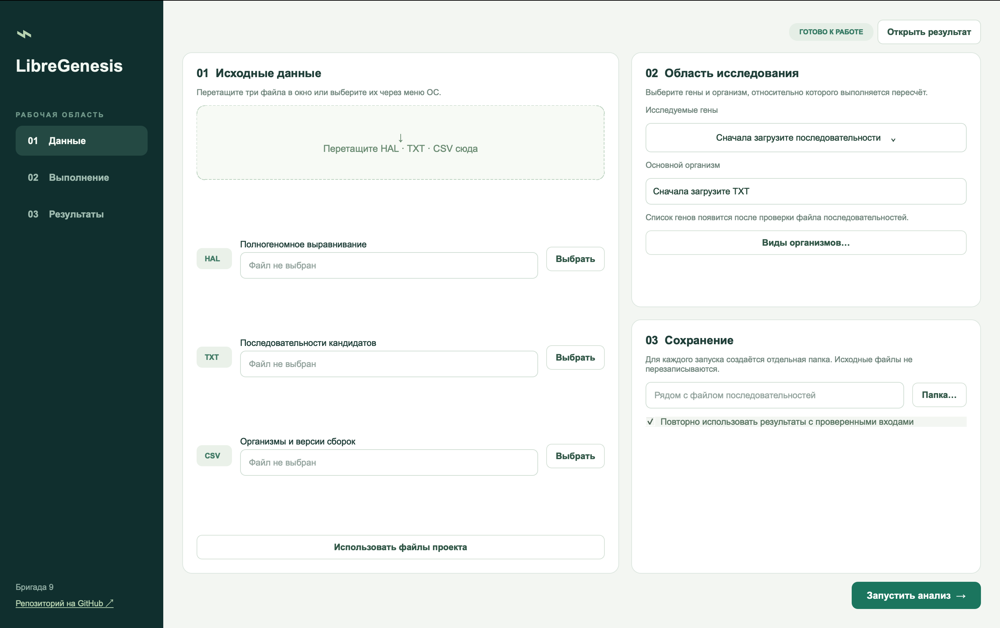
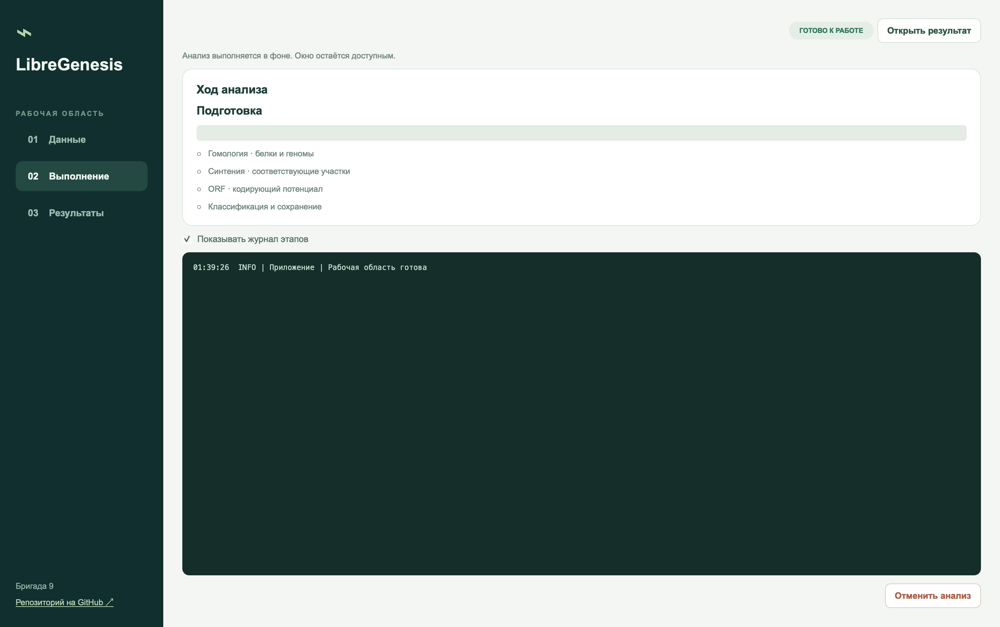
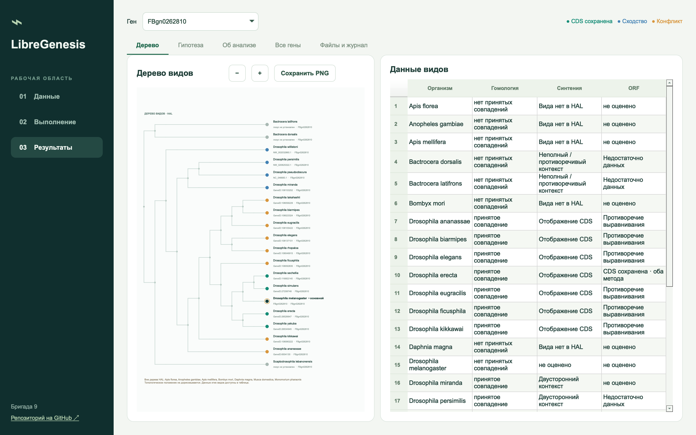

    
 

> [!NOTE]
> **Эта программа разработана в рамках химбио-хакатона "СИНТЕЗ"**
> Команда "Бригада 9"
> Кейс №2

## Системные требования
**Сборка для macOS** - Mac с Apple Silicon (M1 и новее). Qt, BLAST+ и HAL включены в приложение; устанавливать их отдельно не требуется.  

**Сборка для Linux**  - компьютер с процессором x86_64.
Текущая сборка использует системный Qt 6.11.2; BLAST+ и HAL находятся в папке Tools рядом с каталогом build-linux, устанавливать их отдельно не требуется. 

> [!IMPORTANT]
> Для первоначальной загрузки биологических баз нужны доступ к интернету и около 13 ГБ свободного места, дополнительно потребуется место для исходных данных и результатов.
## Загрузка
Скачайте [актуальный релиз LibreGenesis](https://github.com/noonecanhearyou/sintez-c2-b9/releases/latest) для вашей ОС по ссылке.
  
## Запуск анализа
Выберите три исходных файла — HAL, TXT и CSV через кнопки выбора или перетащите их в окно. Отметьте нужные гены, основной организм и виды сравнения, при необходимости укажите папку сохранения (по умолчанию выходные файлы сохранятся в каталог с исходными данными) и нажмите **«Запустить анализ»**. Ход выполнения отображается на экране, расчёт можно остановить. Недостающие настроенные базы загружаются автоматически.  

## Ход анализа
По ходу анализа отображается прогресс-бар. Также отображается консольный вывод для удобства работы.

## Просмотр результатов
во вкладке **«Дерево»** выберите ген из выпадающего списка, увеличивайте дерево кнопками или колесом мыши и нажимайте на виды для выделения их данных в таблице. Обоснование классификации и оценка поддержки находятся во вкладке **«Гипотеза»**. Результаты и журналы сохраняются автоматически, а для повторного просмотра используйте **«Файл → Открыть результат»** и выберите папку завершённого анализа — пересчёт не нужен.  

## Ссылки 
1. BLAST+: architecture and applications / C. Camacho, G. Coulouris, V. Avagyan [et al.] // BMC Bioinformatics. – 2009. – Vol. 10. – Art. 421.
2. HAL: a hierarchical format for storing and analyzing multiple genome alignments / G. Hickey, B. Paten, D. Earl [et al.] // Bioinformatics. – 2013. – Vol. 29, № 10. – P. 1341–1342. – DOI: 10.1093/bioinformatics/btt128.
